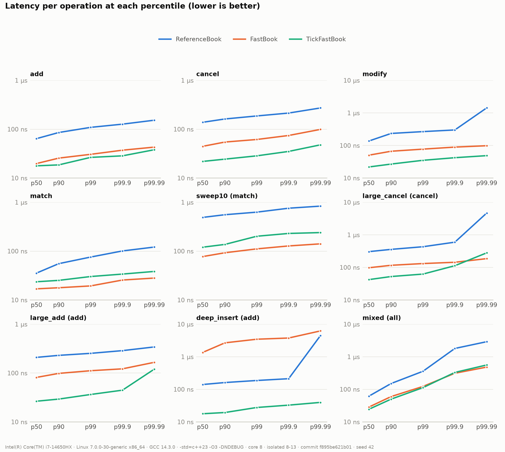
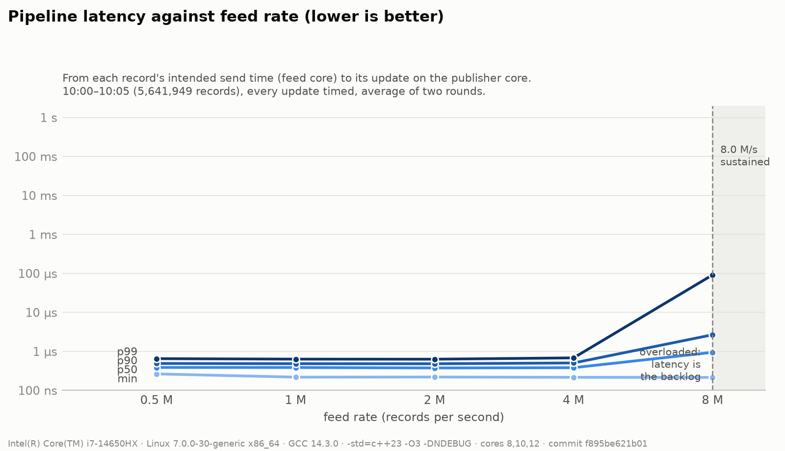
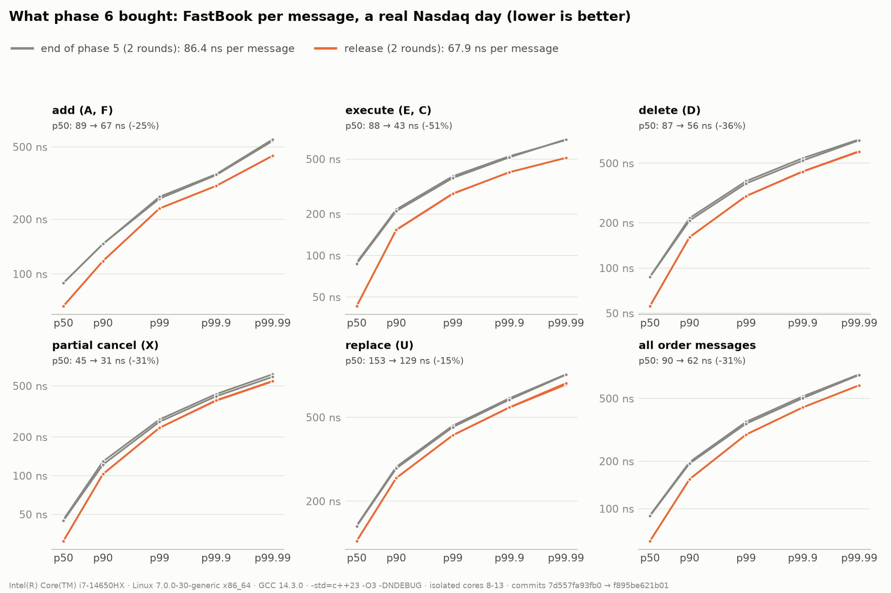
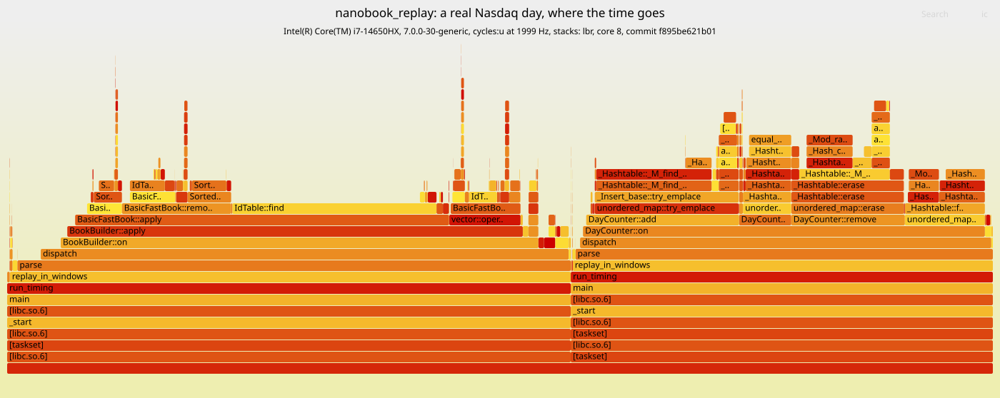

# NanoBook

[](https://github.com/weijun-t/NanoBook/actions/workflows/ci.yml)

A limit order book and matching engine in C++23, built to be fast and to prove it. It rebuilds the
full book of every Nasdaq stock from a real trading day (368 million ITCH 5.0 messages) at **68 ns
per message on one core**, with **no heap allocation and no page fault while trading**. After
every one of the day's 363 million order messages, it matches a slow, obviously correct reference
book. Every number below was measured on bare-metal Linux, and you can rerun the checks in about
a minute.

## Results

Bare metal, one session, one commit (`f895be6`). Two rounds each; a range is round 1 to round 2.

| What | p50 | p99 | p99.99 | Throughput |
|---|---|---|---|---|
| Add an order (synthetic, 1M samples each) | 19.8–21.9 ns | 30.6–33.9 ns | 43.0–44.2 ns | |
| Cancel an order | 44.6–45.1 ns | 61.6–62.0 ns | 92.2–99.2 ns | |
| Modify an order | 50.4–50.8 ns | 76.9–77.3 ns | 98.0–98.4 ns | |
| Match (one order fully fills one resting order) | 16.9–17.4 ns | 19.4–19.8 ns | 28.1–32.2 ns | |
| **The real Nasdaq day**, every 8th order message timed | 62.4–62.8 ns | 295.6 ns | 607.6–610.5 ns | **67.7–68.0 ns per message** (14.7 M/s) |
| **Three-thread pipeline**, feed to publisher, at 1 / 2 / 4 M messages/s | 383–390 / 375–379 / 381–384 ns | 631–638 / 630–634 / 680–686 ns | 0.96–1.53 µs | |

- **Machine:** Intel Core i7-14650HX, Ubuntu 26.04.1 LTS (live USB, not a VM), Linux
  7.0.0-30-generic with `isolcpus=8-13 nohz_full=8-13`, pinned to core 8 (pipeline: 8, 10, 12),
  `performance` governor, turbo on. GCC 14.3.0, `-std=c++23 -O3`, no `-march=native`, LTO or PGO.
- **Data:** Nasdaq TotalView-ITCH 5.0, 30 January 2019 (`scripts/fetch_itch.sh`). Times are in
  ns with the timer's own overhead subtracted. Raw output: `docs/data/bare_metal/release/`.
- **Phase 6's optimisations, in total:** 86.4 → 67.9 ns per message on the real day, p50 90 → 62
  ns. One cost: `match` is 8–17% slower in the synthetic micro-benchmarks since the 8-byte ID
  entries (E9b); the real day is 9–10% faster, and its matches are 13–21% faster at p50
  (`docs/perf-log.md`, 2026-10-25).







**Where the time goes** (the real day, `perf` with LBR call stacks;
[open the SVG](docs/img/release_flamegraph.svg) to zoom). The graph covers the whole program: the wide tower under `BookBuilder` is the timed
replay (48.5% of samples), and the one under `DayCounter` is the untimed pre-scan that sizes the
books (41%). Inside the timed replay, the order-ID table takes 60% of the time and the price
levels 24%.



The rebuilt book looks like a market (AAPL at the close):


## Quickstart

Needs Linux on x86-64, GCC 14, CMake 3.25 or newer, and Ninja. On Ubuntu 24.04:
`sudo apt-get install -y cmake ninja-build g++-14`.

```bash
git clone https://github.com/weijun-t/NanoBook.git
cd NanoBook
scripts/reproduce.sh        # build, 837 tests, 30M fuzzed operations, the latency table
```

It takes **55 s** from a fresh clone on the machine above, including the GoogleTest and Google
Benchmark downloads. It prints your
latency next to the published numbers. On a laptop, a VM or a busy machine yours will be slower,
and the tools say so (a `NOT FOR PUBLISHING` banner on a VM). Output goes to `repro/`.

The full level adds the real day and the pipeline. It needs the day's file: a 4.76 GB download
(about 6 minutes at 100 Mbit/s) that unpacks to 11.2 GB.

```bash
scripts/fetch_itch.sh
scripts/reproduce.sh --itch data/itch/01302019.NASDAQ_ITCH50/01302019.NASDAQ_ITCH50
```

The tools, one at a time (built in `build/gcc-release/`; every command, with what it tells you: [Every command](#every-command)):

| Tool | Does |
|---|---|
| `nanobook_replay FILE --throughput --latency --core C` | Replays the day: messages per second, latency per message kind |
| `nanobook_bench --scenario match --core C` | Per-operation latency of the synthetic scenarios, percentiles and histogram |
| `nanobook_fuzz --ops N --seeds S` | Random orders into the fast book and the reference book; PASS, or the first difference |
| `nanobook_pipeline FILE --cores A,B,C --latency --rate R` | The three-thread pipeline, paced at R messages a second |
| `nanobook_pipeline FILE --view NAME --speed N --from HH:MM:SS` | The pipeline at N× the market's own clock, every stock's best bid and ask in shared memory |
| `nanobook_view [NAME]` | The live watchlist of that table (below); built with `-DNANOBOOK_BUILD_VIEWER=ON` |
| `nanobook_depth FILE SYMBOL --speed N --from HH:MM:SS` | One stock's whole book, live: price levels, the queue at each price, its tape (below); also built with `-DNANOBOOK_BUILD_VIEWER=ON` |

## Watch it run

The real day, live: every stock's best bid and ask, the replay's speed, and the latency of the
last second. The viewer is **another process**: the publisher thread writes each update into a
table in shared memory, and the viewer reads it ten times a second. The engine never knows it's
there, and the publisher never waits for it.

```bash
cmake --preset gcc-release -DNANOBOOK_BUILD_VIEWER=ON     # also downloads FTXUI
cmake --build build/gcc-release --target nanobook_pipeline nanobook_view
./build/gcc-release/nanobook_view nanobook                # terminal 1: waits for the table
./build/gcc-release/nanobook_pipeline data/itch/01302019.NASDAQ_ITCH50/01302019.NASDAQ_ITCH50 \
    --view nanobook --speed 60 --from 09:30:00            # terminal 2: 60x from the open
```

```
╭──────────────────────────────────────────────────────────────────────────────────────────────────────────╮
│ NanoBook /dev/shm/nanobook                                                                       running │
│ ITCH 09:37:05.021   speed 60.3x   1,383,697 updates/s   19,896,551 in all                                │
│ latency, last 1 s (1,385,604 paced): p50 0.63 us  p99 396.19 us  p99.9 778.84 us  (sped-up bursts queue) │
├──────────────────────────────────────────────────────────────────────────────────────────────────────────┤
│  SYMBOL      BID SIZE          BID          ASK    ASK SIZE    SPREAD      BPS     UPD/S      UPDATES    │
│  QQQ              403     163.7200     163.7300         700    0.0100     0.61    17,690      224,961    │
│  SPY              601     265.0600     265.0700         162    0.0100     0.38    15,647      157,530    │
│  AMD            3,195      22.2200      22.2300         400    0.0100     4.50    14,843      113,532    │
│  FBGX           1,000     215.1300     216.5300       1,000    1.4000    64.87    12,192       46,822    │
│  AAPL             100     162.0700     162.1100         100    0.0400     2.47    11,791      134,724    │
│  IWM              500     146.7400     146.7500         100    0.0100     0.68     8,346       87,431    │
│  VALE          10,000      12.3500      12.3600       5,478    0.0100     8.09     8,047       80,102    │
│  GOOG              12    1073.9900    1075.1800           1    1.1900    11.07     7,939       79,993    │
│  MU               200      38.4800      38.4900         400    0.0100     2.60     7,859       63,877    │
│  AABA             600      66.9700      66.9800          80    0.0100     1.49     7,705       47,741    │
│  TQQQ             100      43.5300      43.5400           1    0.0100     2.30     6,862       74,179    │
│  ONEQ             200     277.6100     278.2700         100    0.6600    23.75     6,712       47,157    │
│  GOOGL            110    1084.0600    1084.9700           2    0.9100     8.39     6,674       98,013    │
│  XLI              300      70.6800      70.6900         700    0.0100     1.41     6,438       38,150    │
│  TVIX             100      45.7200      45.7400         100    0.0200     4.37     6,278       80,534    │
├──────────────────────────────────────────────────────────────────────────────────────────────────────────┤
│ up/down move  p pin  / filter  s sort: activity  q quit                                                  │
╰──────────────────────────────────────────────────────────────────────────────────────────────────────────╯
```

- **The engine is untouched:** the full day's log has the same checksum with the viewer on and
  off (`748abedf40533b82`, as in phase 5).
- **Each stock's slot is a seqlock** of 64 bytes: the publisher writes without ever waiting, and
  a reader that catches a slot mid-write throws its copy away and reads it again next frame.
- **An update is one order message**, not a price change: after each, the publisher gets the
  stock's best bid and ask, moved or not. `UPD/S` counts a stock's order traffic; the screen
  shows each stock's latest L1 and skips the updates between two redraws.
- **Latency above 1× is mostly queueing:** at 60× a burst Nasdaq spread over 1 ms arrives in
  17 µs, and the feed stamps when each update was *due*, so the wait counts. At 1× the same
  screen shows a p99 of 31–54 µs on WSL2.
- **What it costs the pipeline** (bare metal, 1–4 M records/s): writing the table, nothing
  measurable; with the viewer attached, p99 +6 to +45 ns (1–7%), not clearly beyond the noise.
- Keys: arrows to move, `p` pin, `/` filter, `s` sort (activity, symbol, spread), `q` quit.
  Design: `docs/viewer-design.md`; what was built and tested: `docs/viewer-report.md`.

## Watch one stock

One stock's **whole book**: the best 10 prices on each side with their shares and orders (L2),
and the queue of orders waiting at a chosen price, front first (L3), with the shares ahead of
each one. It's a **second copy of the book**, rebuilt from the same file by its own replay, the
way a trading firm keeps its own copy: the engine and the pipeline never know it exists.

```bash
cmake --build build/gcc-release --target nanobook_depth      # after the viewer's configure above
./build/gcc-release/nanobook_depth data/itch/01302019.NASDAQ_ITCH50/01302019.NASDAQ_ITCH50 AMD \
    --speed 1 --from 10:30:00
```

AMD at 10:30, paused, following the newest order at the best bid (5th in line, 900 shares ahead):

```
╭────────────────────────────────────────────────────────────────────────────────────────────────────────────╮
│ NanoBook depth  AMD                                                      ITCH 10:30:02.704   1.0x   paused │
│ bid 22.0800 x 1,400    ask 22.0900 x 2,900    spread 0.0100 (4.53 bps)    14,322 resting    state T        │
│ last trade 22.0900 x 200 at 10:30:02.233    messages 655,410    reference: matches (655,410 checks)        │
│ following 72,130,821: 5th in line at bid 22.0800, 500 shares, 900 ahead of it                              │
├─────────────────────────────────────────────────────┬──────────────────────────────────────────────────────┤
│    ORDERS       SHARES           BID                │ ASK                 SHARES   ORDERS                  │
│>        5        1,400       22.0800                │ 22.0900              2,900        1                  │
│         8        2,100       22.0700                │ 22.1000             22,504       30                  │
│         8        1,500       22.0600                │ 22.1100              2,000        8                  │
│         9        2,400       22.0500                │ 22.1200             13,600       24                  │
│         9       11,492       22.0400                │ 22.1300              4,309       12                  │
│         6        1,400       22.0300                │ 22.1400              2,009       13                  │
│         7        3,822       22.0200                │ 22.1500             49,216       54                  │
│         6        1,542       22.0100                │ 22.1600              2,490       15                  │
│        21       12,666       22.0000                │ 22.1700             10,567       17                  │
│        11        2,142       21.9900                │ 22.1800             10,124       19                  │
├─────────────────────────────────────────────────────┴──────────────────────────────────────────────────────┤
│ QUEUE  bid 22.0800  (5 orders, 1,400 shares; front first)                                                  │
│  PLACE        ORDER ID      SHARES         AHEAD  SINCE         ATTRIBUTION                                │
│      1      72,124,781         500             0  10:30:01.885                                             │
│      2      72,124,785         100           500  10:30:01.885                                             │
│      3      72,124,801         100           600  10:30:01.885                                             │
│      4      72,124,829         200           700  10:30:01.886                                             │
│      5      72,130,821         500           900  10:30:02.225                                             │
│                                                                                                            │
│                                                                                                            │
│                                                                                                            │
├────────────────────────────────────────────────────────────────────────────────────────────────────────────┤
│ TAPE  AMD, newest first                                                                                    │
│ 10:30:02.611  DELETE   72,134,445                    S         200 @ 22.0900                               │
│ 10:30:02.611  DELETE   72,134,437                    S         200 @ 22.0900                               │
│ 10:30:02.464  DELETE   72,124,793                    B         400 @ 22.0800                               │
│ 10:30:02.464  ADD      72,134,453                    B         400 @ 22.0500                               │
│ 10:30:02.464  ADD      72,134,449                    S         400 @ 22.1300                               │
│ 10:30:02.464  ADD      72,134,445                    S         200 @ 22.0900                               │
│ 10:30:02.464  DELETE   72,036,661                    B         400 @ 22.0000                               │
├────────────────────────────────────────────────────────────────────────────────────────────────────────────┤
│ up/down level  tab side  space pause  n step  f follow  +/- speed  q quit                                  │
╰────────────────────────────────────────────────────────────────────────────────────────────────────────────╯
```

- **Pause, step, follow:** Space pauses; `n` applies the stock's next message, so you see what
  each one does to the book; `f` follows the newest order in the shown queue until it fills or
  leaves. Up/down picks a price, Tab the side, `+`/`-` the speed.
- **Checked live:** phase 1's reference book gets every message too. The two are compared after
  each one; a difference turns the check red and stops the replay on that message.
- **Checked on the real day:** `nanobook_depth FILE --check-day AAPL,SPY,QQQ` compares each
  stock's copy with a full replay of every stock at the open, every hour and the end: equal at
  all 9 moments for all three (AAPL up to 42,767 resting orders), the reference agreeing after
  each of their 8.2 million messages.
  Design: `docs/depth-design.md`; what was built and tested: `docs/depth-report.md`.

## How it works

```
 ITCH file ──► Parser ──SPSC ring──► Engine: one book per stock ──SPSC ring──► Publisher / log
 (1 GiB windows) (core A)            (core B, single-threaded)                (core C)
```

- **Orders** live in one array of fixed slots made at start-up. Each price level's queue is a
  doubly linked list through the slots, by `uint32_t` index, not pointer.
- **Price levels:** one sorted array per side, best price at the end. A lookup checks the 4
  levels nearest the best price, then binary-searches.
- **Order ID → slot:** an open-addressing hash table (linear probing, 8-byte entries).
- **Memory:** everything is sized once from a pre-scan of the day and placed on 2 MiB huge pages,
  touched at start-up. That's why there are 0 allocations and 0 page faults while trading.
- **Threads** pass records through NanoBook's own lock-free single-producer, single-consumer
  rings (acquire/release, counters 128 bytes apart). The book itself never sees a second thread.

The designs, with every alternative weighed: `docs/design.md` (start here).

## How it's tested

- **An answer key:** a reference book on `std::map` and `std::list`, simple enough to check by
  eye. The fast book must produce the same events and the same book: on 162 million random
  operations (phase 2), 30 million more in every `reproduce.sh` run, and after every one of the
  real day's 363,118,215 order messages (0 mismatches).
- **837 GoogleTest tests** (849 with the viewer and depth layout tests), run by CI in 6 builds: GCC and Clang, each with Debug + ASan + UBSan,
  Release, and ThreadSanitizer. CI also checks `clang-format` and `clang-tidy`, and runs
  libFuzzer on the ITCH parser for 60 s.
- **Zero allocations:** 19 of those tests replace `operator new` and fail if the fast book
  allocates while trading. (The sanitizer builds leave them out, as ASan and TSan replace
  `operator new` themselves, so those builds run 800.)
- **The engine is built with `-fno-exceptions`**, and every build treats warnings as errors.

## Trade-offs

The full list, with what was tried instead and the evidence: `docs/interview-notes.md`.

- **Sorted array of price levels, not a tick-indexed array.** The tick array was up to 3.9× faster
  on cancels, but sizing one for every stock's real price range would need 489,000 GB.
- **8-byte ID-table entries.** The table is over half the replay's time, so twice as many entries
  per cache line made the day 7% faster. The cost: one extra read to confirm a match (above).
- **Three threads are slower than one** (0.78× unpaced). The book is 96% of the work, and every
  hand-over moves cache lines between cores. A pipeline pays only when it takes slow work, like
  disk writes, off the engine.
- **Huge pages, touched at start-up:** 7% faster on the day, and no page fault while trading.
- **A moving window of price slots near the best price** was 15% faster on average but its p99.99
  was 2.5–6× worse. It stays a tested option (`--book window`), not the default.
- **Published only from bare metal.** On WSL2 the pipeline's p99 was 65–72 µs; on isolated cores
  it's 0.65 µs. That tail was the virtual machine.

## Every command

Every command a visitor might run, grouped by the question it answers. Shorthand:
`B=build/gcc-release` (built by `scripts/reproduce.sh` or `cmake --workflow --preset gcc-release`)
and `FILE=data/itch/01302019.NASDAQ_ITCH50/01302019.NASDAQ_ITCH50` (from `scripts/fetch_itch.sh`).
`--core C` pins a run to one CPU core so its numbers are steady. Times are from the laptop above.
Every tool prints its usage when given a wrong flag.

**Getting started**

| Command | What it does | What it tells you |
|---|---|---|
| `scripts/reproduce.sh` | Builds, runs the 837 tests, fuzzes 30M operations, times the book (about 1 min) | Whether it all works on your machine, and your latency next to the published numbers |
| `scripts/fetch_itch.sh` | Downloads the real Nasdaq day (4.76 GB, unpacks to 11.2 GB) | Nothing yet: it's the input for every command that takes `$FILE` |
| `scripts/reproduce.sh --itch $FILE` | The above, plus the real day's replay and the pipeline | The day's throughput and latency on your machine |
| `ctest --preset gcc-release` | Runs every test again | Pass or fail for each test |

**Is it correct?**

| Command | What it does | What it tells you |
|---|---|---|
| `$B/nanobook_fuzz --seeds 3 --ops 10000000` | Sends the same random orders to the fast book and the simple reference book, and compares every event (13 s) | `PASS` for each seed, or the first operation where the two books disagree |
| `$B/nanobook_replay $FILE --check --differential` | Replays the whole day through both books, checking the book's structure as it goes (about 5 min) | 0 mismatches: a quick comparison after each of the 363 million order messages, and 61,354 full comparisons of the two books |
| `$B/nanobook_depth $FILE --check-day AAPL,SPY` | Replays only those stocks (the depth view's way) and compares them with a full replay at the open, every hour and the close (about 1.5 min) | `PASS` for each stock: equal at 9 of 9 checkpoints, the reference book agreeing too, and the most orders resting at once |

**How fast is it?**

| Command | What it does | What it tells you |
|---|---|---|
| `$B/nanobook_bench --core 2` | Times each kind of operation (add, cancel, modify, match, …) one at a time, on the reference book and the fast books | Latency percentiles in nanoseconds (p50 to max) and allocations while timing (0 for the fast books). `--csv FILE.csv` also saves a histogram |
| `$B/nanobook_bench --core 2 --throughput` | The same scenarios, run flat out | Operations per second, so the fast book can be compared with the reference |
| `$B/nanobook_replay $FILE --throughput --latency --core 2` | Replays the real day as fast as it can, then again timing every 8th order message (about 2 min) | Messages per second for the whole day, and latency percentiles for each message kind (add, cancel, execute, …) |
| `$B/nanobook_pipeline $FILE --cores 2,4,6 --throughput` | The day through three threads on three cores: parser, engine, publisher | Messages per second for the pipeline, to compare with the one-thread replay |
| `$B/nanobook_pipeline $FILE --cores 2,4,6 --latency --rate 1000000 --from 10:00:00 --until 10:05:00` | Feeds five minutes of the day at a steady million messages a second | Time from a message going in to its result coming out, as percentiles |
| `$B/nanobook_ringbench --cores 2,4` | Passes records between two cores through the lock-free ring | What one hand-over between threads costs |
| `$B/nanobook_microbench` | Google Benchmark loops over the book (needs `-DNANOBOOK_BUILD_BENCH=ON`) | Time per operation, and allocations per operation (0) |

**Show me the market**

| Command | What it does | What it tells you |
|---|---|---|
| `$B/nanobook_replay $FILE --symbol AAPL --depth 10 --until 12:00:00` | Replays up to noon and prints one stock's book | Messages by type and how each was handled, the stocks with the biggest books, and AAPL's 10 best bid and ask prices at noon with the shares at each |
| `$B/nanobook_replay $FILE --symbol AAPL --until 12:00:00 --snapshot-csv aapl.csv`, then `.venv/bin/python scripts/plot_depth.py aapl.csv` | Saves the stock's whole book at noon, then draws it (`aapl.png`) | A picture of how many shares wait at each price on each side |
| `$B/nanobook_pipeline $FILE --view nb --speed 60 --from 09:30:00`, and in a second terminal `$B/nanobook_view nb` | Runs the day at 60× the market's clock and shows every stock's best prices live | A watchlist: best bid and ask, spread, updates per second, the busiest stocks |
| `$B/nanobook_depth $FILE AAPL --speed 1 --from 10:30:00` | Replays one stock live from 10:30 | Every price level, the queue of orders at each price, the trade tape. Keys: ↑↓ move, Tab switches side, Space pauses, `f` follows an order through the queue, `+`/`-` change speed, `q` quits |

The live viewer and the depth view need `-DNANOBOOK_BUILD_VIEWER=ON` (see "Watch it run").

**Going deeper**

| Command | What it does | What it tells you |
|---|---|---|
| `python3 scripts/itch_slice.py $FILE morning.itch --until 09:31:00` | Cuts the start of the day into a small file | A quick input for the commands below |
| `$B/nanobook_pipeline morning.itch --log out.bin --checksum` | Runs the pipeline and writes every best-price update it publishes to a log. Use a slice: the whole day's log is about 17 GB | How many updates went out, how often the rings were full, and a checksum to compare runs with |
| `$B/nanobook_logdump out.bin --head 3` | Prints the log as CSV | What the engine sent out: one line per update, with its time, stock, best bid and best ask |
| `$B/nanobook_replay $FILE --flow` | Watches how the price levels change through the day (about 4 min) | How many levels each new price level pushes along the sorted array, how far from the best price orders land, and how a moving window of price slots would have done: the evidence behind the data-structure choice |
| `scripts/flamegraph.sh $FILE out/ --core 2` | Profiles the replay with `perf` (about 3 min) | A flame graph of where the time goes (the ID table, the price levels, …) |
| `scripts/run_ab_session.sh BEFORE_REF out/ -- nanobook_bench --core 2` | Builds an older commit and the current tree, and runs them in turns | Whether a change made things faster, with the noise between rounds shown |

Publishing numbers takes bare metal: on WSL2 or another VM every timing tool prints a
`NOT FOR PUBLISHING` banner. The scripts behind the published numbers
(`run_latency_session.sh`, `run_pipeline_session.sh`, `run_release_session.sh`,
`run_viewer_session.sh`) explain their use at the top of each file.

## Read more

| Document | What's in it |
|---|---|
| `docs/plan.md` | How the project was run: scope, the rules (hot path, correctness, measurement), the roadmap |
| `docs/final-report.md` | The whole story in plain words: every test, why, what it told us, so what; the conclusion |
| `docs/interview-notes.md` | Each decision: chose, instead of, because, would revisit if; likely questions |
| `docs/design.md` | The reference book and the engine's interface (phase 1) |
| `docs/fast-book-design.md` | The fast book's data structures (phase 2) |
| `docs/latency-harness-design.md` | The `rdtsc` harness and how to read its numbers (phase 3) |
| `docs/itch-design.md` | The ITCH 5.0 parser, the book builder, the real-day replay (phase 4) |
| `docs/pipeline-design.md` | The rings and the three-thread pipeline (phase 5) |
| `docs/optimise-design.md` | The 11 optimisation experiments and their rules (phase 6) |
| `docs/polish-design.md` | This front page, reproducing, the flame graph (phase 7) |
| `docs/viewer-design.md` | The live viewer: the shared-memory table, its seqlock, ITCH-clock pacing |
| `docs/phase1-report.md` … `docs/phase6-report.md` | What each phase built, measured and learned |
| `docs/viewer-report.md` | What the viewer is, how it was tested (12 planted bugs), what watching it taught |
| `docs/bare-metal-report.md` | The bare-metal sessions: phases 3–6's published numbers |
| `docs/perf-log.md` | Every performance number, with its machine and commit, in date order |

## Status

| Phase | |
|---|---|
| 0. Setup | Done: CMake presets, GCC and Clang, sanitizers, CI |
| 1. Reference book | Done: limit, market, cancel, modify, IOC, FOK, by price-time priority |
| 2. Fast book | Done: 0 allocations while trading, equal to the reference on 162M random operations |
| 3. Latency harness | Done: `rdtsc` per operation, percentiles, published from bare metal |
| 4. ITCH 5.0 replay | Done: the real day, every check passing, equal to the reference after every message |
| 5. Pipeline | Done: three pinned threads over SPSC rings, TSan clean, log identical to one thread |
| 6. Optimise | Done: 11 experiments, 4 kept, each with a before/after table, re-checked on bare metal |
| 7. Polish | Done: this front page, one-command reproduction (55 s), flame graph, interview notes, final report |
| Viewer (after the roadmap) | Done: a live watchlist in a separate process; its cost to the pipeline measured on bare metal |
| Depth view (after the viewer) | Done: one stock's levels and queues from its own replay, checked against a full replay on the real day |
