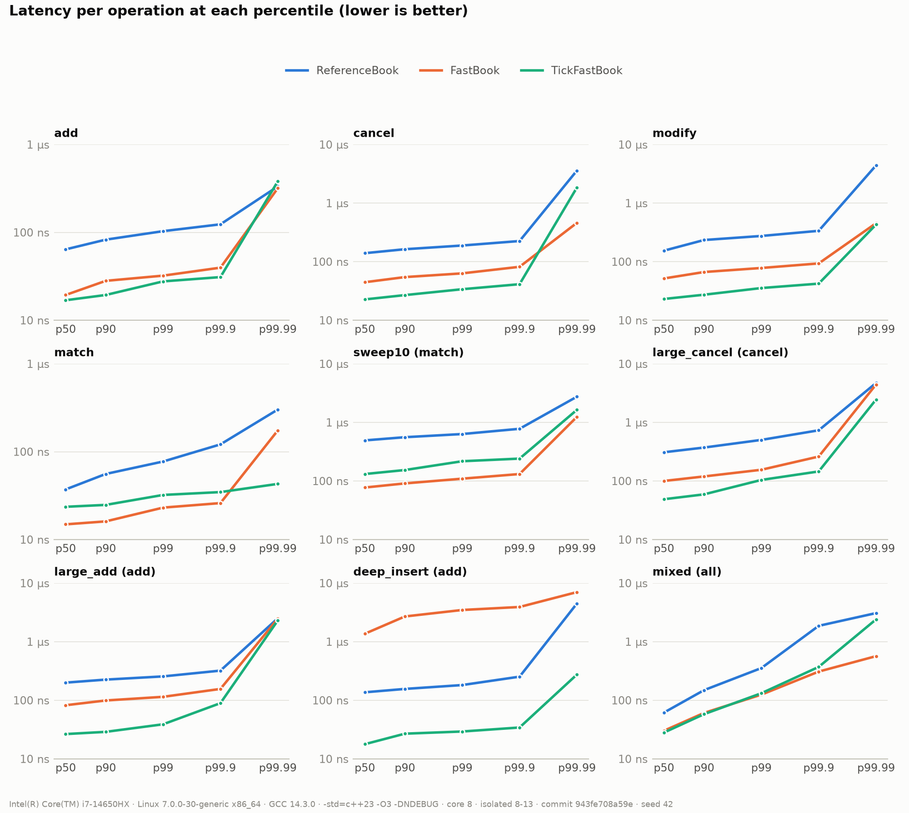
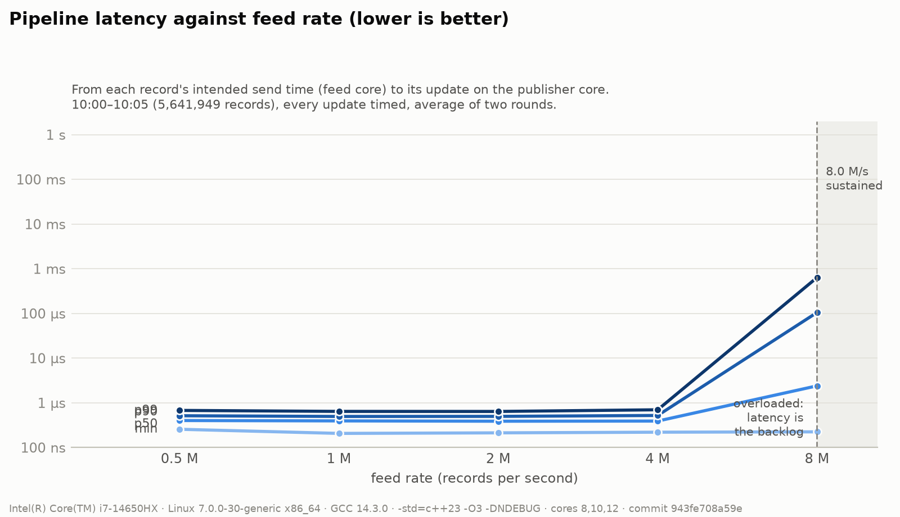

# NanoBook: Bare-Metal Session Report

**Phases 3–5 published numbers and phase 6's re-checks** · 24 October 2026 · C++23, GCC 14.3.0, Ubuntu 26.04.1 LTS on bare metal · Session run; decisions pending (§6)

---

## 1. Summary

Every number before this session came from WSL2, a virtual machine, and was marked "not for
publishing" (README rule 20). This session ran the same tools on the same laptop, booted into
Linux directly from a USB stick, with three physical cores set aside for the measurements. It
does two jobs: it produces the **published numbers** for phases 3, 4 and 5, and it **re-checks
phase 6's decisions** (optimise design §5, B1–B7), using rules written down before the data.

| | |
|---|---|
| Status | **All runs done**, in one session on 24 October. Raw data in `docs/data/bare_metal/`. Three decisions wait for the user (§6) |
| Real Nasdaq day, one thread | **75 ns per message** (13.4 M messages/s); WSL2 at the end of phase 6: about 92 ns |
| Real day, slowest 1 in 10,000 messages (p99.99) | **0.65 µs**; WSL2: about 11 µs |
| Pipeline p99 at 1–4 M messages/s | **about 0.65 µs**; WSL2: 65–72 µs |
| Kept changes re-checked | E1b, E3, E6 **confirmed**; E2 **fails** its rule (revert) |
| Undecided change E9b | **passes** its rule: 7% faster, p50 24% better (re-add) |
| Moving window E7 | 15% faster, p99 now equal, but p99.99 2.5–6× worse |

**The one-sentence lesson:** the virtual machine hid good news as well as bad: the pipeline's
65 µs tail was the VM, not the code, and E9b's gain was real but drowned in WSL2's noise.

---

## 2. The setup

### 2.1 The machine

| | |
|---|---|
| CPU | Intel Core i7-14650HX (8 performance cores with two hyperthreads each, 8 efficiency cores; 24 logical CPUs) |
| OS | **Ubuntu 26.04.1 LTS**, live USB stick with a persistent partition, booted directly (no virtual machine) |
| Kernel | Linux 7.0.0-30-generic, boot options `isolcpus=8-13 nohz_full=8-13 rcu_nocbs=8-13` |
| Cores used | CPU 8 for one-thread runs; CPUs 8, 10, 12 for the pipeline (three different performance cores); their hyperthread twins 9, 11, 13 left idle |
| Frequency | `performance` governor, **turbo on** (CPU 8 ran at 5.2 GHz, read from the cycle counter) |
| Compiler | GCC 14.3.0, `gcc-release` preset: `-std=c++23 -O3 -DNDEBUG` |
| Code | Commit `943fe70` (clean tree, rebuilt before each session) unless the A/B says otherwise |
| Input | Nasdaq TotalView-ITCH 5.0, 30 January 2019, 11.2 GB, 368,366,634 messages, read-only from the Windows drive |
| Power | Plugged in, laptop idle |

### 2.2 What the three boot options do
- `isolcpus=8-13`: Linux puts no other program on CPUs 8–13. Only our pinned threads run there.
- `nohz_full=8-13`: the timer tick (an interrupt every few milliseconds) stops on those CPUs
  while one thread runs, so the measured code isn't interrupted.
- `rcu_nocbs=8-13`: a kernel housekeeping job (RCU callbacks) moves to the other CPUs.

Together they answer B4: are the slow tails the code's fault or the machine's?

### 2.3 Every tool checked the setup itself
Each output starts with the environment the tool read from the system: `virtual machine no`,
`isolated cores 8-13`, `governor performance`, `turbo on`. The "NOT FOR PUBLISHING" banner, printed
whenever a hypervisor is found, is gone from every file.

---

## 3. Published numbers

### 3.1 Phase 3: one operation at a time (synthetic books)
`scripts/run_latency_session.sh docs/data/bare_metal/phase3 --core 8`: 1,000,000 timed operations
per scenario, two rounds. FastBook, round 1 / round 2, in ns:

| Scenario | p50 | p99 | p99.99 | WSL2 p99.99 |
|---|---|---|---|---|
| add | 19.4 / 20.3 | 32.2 / 30.2 | 318 / 299 | 2,229 |
| cancel | 44.6 / 44.2 | 63.2 / 62.4 | 461 / 137 | 2,433 |
| modify | 51.7 / 51.7 | 78.1 / 77.3 | 454 / 354 | 2,400 |
| match | 14.9 / 15.3 | 23.1 / 19.4 | 174 / 42 | 2,359 |
| sweep10 | 77.3 / 74.8 | 109.5 / 105.4 | 1,244 / 799 | 9,635 |
| mixed | 30.2 / 30.6 | 124.8 / 125.2 | 566 / 556 | 4,046 |

- **p50 and p99 barely moved** from WSL2. The code's own speed was measured correctly there.
- **p99.99 fell 5–50×.** On WSL2 every scenario had a floor of about 2.3 µs, the same in every
  test: that was the virtual machine pausing, not the code. With an isolated core it's gone.
- p99.99 still varies between rounds (e.g. match 174 vs 42 ns): at 1 in 10,000 a few slow
  samples decide it, so it's reported with both rounds.

### 3.2 Phase 4: the real Nasdaq day through FastBook
`nanobook_replay FILE --throughput --latency --core 8 --csv ...`, twice. Every 8th order message
timed (45,389,776 samples).

| | Round 1 | Round 2 | WSL2 (phase 4, commit c13e5bb) |
|---|---|---|---|
| ns per message (throughput) | 74.7 | 75.4 | 102.3 |
| Parse only | 2.7 ns | 4.0 ns | 3.0 ns |
| p50, all kinds | 85.2 | 83.9 | 105 |
| p99 | 322.8 | 312.5 | 429 |
| p99.9 | 472.1 | 453.5 | — |
| p99.99 | 4,001 | 647 | about 11,000 |
| Page faults while timed | 0 | 0 | not counted then |

Per message kind, round 2 (ns):

| Kind | ITCH | p50 | p90 | p99 | p99.99 |
|---|---|---|---|---|---|
| add | A, F | 85.6 | 131.9 | 244.7 | 519 |
| match | E, C | 49.2 | 167.4 | 300.9 | 548 |
| cancel | D | 64.9 | 178.2 | 321.2 | 634 |
| modify | X | 29.8 | 98.8 | 237.7 | — |
| replace | U | 141.4 | 269.5 | 421.6 | 756 |

- About a quarter faster than at the end of phase 4: phase 6's kept changes (§4) plus no VM.
- **Round 1's 4.0 µs p99.99 is not trusted.** A few light commands ran on other cores during
  that round. Round 2 (647 ns) and the eight later full-day runs of the same code (in §4.5 and §4.6, 636–644 ns)
  agree.
  **Publish round 2.**

### 3.3 Phase 5: the three-thread pipeline
`scripts/run_pipeline_session.sh FILE docs/data/bare_metal/phase5 --cores 8,10,12`.

**One ring between two cores** (`nanobook_ringbench`): round trip p50 175 / 155 ns, p99 204 /
170 ns (WSL2: p50 185 ns). 56–60 ns per record when streaming.

**Paced latency**, from each record's intended send time to its update leaving the publisher
(10:00–10:05, 5,641,949 records, every one timed; round 1 / round 2, ns):

| Rate (records/s) | p50 | p99 | p99.99 | WSL2 p99 |
|---|---|---|---|---|
| 0.5 M | 402 / 403 | 677 / 678 | 1,019 / 1,053 | 65–72 µs |
| 1 M | 397 / 392 | 647 / 641 | 979 / 956 | 65–72 µs |
| 2 M | 386 / 391 | 640 / 645 | 974 / 968 | 65–72 µs |
| 4 M | 394 / 389 | 703 / 696 | 4,181 / 1,393 | 65–72 µs |
| 8 M | overloaded: the backlog grows, latency is the queue | | | |

**This answers B4.** WSL2's p99 was 65–72 µs at every rate, flat: a sign of pauses that have
nothing to do with load. On isolated cores it is **100× lower** and still flat up to 4 M/s. The
code was never the problem; the virtual machine was.

**Whole day, unpaced:** one thread 100.6 ns per message; three threads 124.9 / 125.9 ns (0.80×).
Three threads are still slower than one, as on WSL2 (0.69–0.78×). §5.2 shows why.

---

## 4. Phase 6 re-checks: was each decision right?

Each A/B ran with `scripts/run_ab_session.sh` in ABBA order (before, after, after, before), so a
machine that slowly warms up hits both sides equally. Each rule below was fixed **before** the
data (optimise design §5). "Noise" is the difference between two runs of the same side.

### 4.1 B5-E6: huge pages for the books. **Confirmed: keep.**
E6's commit `43f939e` against its parent, 2 rounds:

| | Before (round 1 / 2) | After (round 1 / 2) |
|---|---|---|
| ns per message | 77.8 / 77.8 | 72.8 / 72.6 |
| p50 | 90.1 / 90.1 | 83.9 / 83.9 |
| p99 | 347.2 / 346.4 | 314.2 / 315.4 |

7% faster in both rounds (noise under 0.3%), p50 and p99 better, the arena "384 MB of it on 2 MiB
pages". The worry was that a VM overstates huge pages' gain (a TLB miss there walks two sets of
page tables). On bare metal the gain is about the same as on WSL2 (5.6%).

### 4.2 B5-E2: touching the level arrays at start-up. **Fails its rule: revert.**
E2's commit `8fd676a` against its parent, 2 rounds:

| | Before (round 1 / 2) | After (round 1 / 2) |
|---|---|---|
| Page faults while timed | 1,650 / 1,650 | 0 / 0 |
| p99.99 | 743.6 / 744.5 | 737.8 / 742.8 |
| p50 | 90.9 / 90.9 | 91.8 / 91.4 |
| ns per message | 87.0 / 87.0 | 87.3 / 87.2 |

E2 removes every page fault, but the rule asks for **p99.99 better in every round beyond the
noise**. It moved 6 ns and 2 ns, while two runs of the same code differ by up to 5 ns. On WSL2 a
page fault cost much more (the VM handles it twice), which is why E2 looked useful there.
**Rule says revert:** the arena stops touching its pages at start-up; the huge pages are then
mapped on first use (about 200 faults a day).

### 4.3 B5-E3: hybrid search near the best price. **Confirmed: keep.**
E3's commit `352207b` against its parent: 87.6 / 86.9 → 77.9 / 77.8 ns per message (**11%
faster**), p50 92.2 → 90.1 ns, p99 360 → 346 ns, cancel p50 89 → 84 ns. Same as WSL2 (10%).

### 4.4 B5-E1: the feed backs off when ring 1 is full. **Confirmed: keep.**
E1's commit `7103344` against its parent, whole day:

| | Before (round 1 / 2) | After (round 1 / 2) |
|---|---|---|
| One thread (control, no ring) | 143.5 / 144.0 ns | 143.6 / 143.8 ns |
| Three threads | 182.3 / 190.0 ns | 156.8 / 155.5 ns |
| "Ring 1 full" tries | 1.36 / 1.39 billion | 24.5 / 23.8 million |

Three threads **16% faster**; the one-thread control didn't move, so the gain is the ring's.

### 4.5 B6: E9b, 8-byte ID-table entries. **Passes its rule: re-add.**
HEAD plus `docs/data/phase6_wsl/e9b_compact/after.diff`, 4 rounds:

| | Before (4 rounds) | After (4 rounds) |
|---|---|---|
| ns per message | 73.0, 72.9, 73.0, 73.0 | 68.2, 68.2, 68.2, 68.3 |
| p50 | 84.3 (all 4) | 63.7–64.5 |
| p99 | 315.8–316.2 | 296.8–297.6 |

**7% faster in every round** (noise 0.1 ns), p50 **24% better**, p99 6% better. On WSL2 the same
change sat inside the noise and was reverted. The profile said half the replay is in the ID
table; halving its entry size fits twice as many entries in each cache line.

### 4.6 B7: the moving window (E7). **Faster, but the slowest messages are slower.**
HEAD with `nanobook_replay`'s timing modes switched to `WindowFastBook`, 4 rounds:

| | FastBook (4 rounds) | WindowFastBook (4 rounds) |
|---|---|---|
| ns per message | 72.7–73.0 | 62.0–62.2 |
| p50 | 84.3–84.7 | 64.5–65.7 |
| p99 | 316.2 | 317.5–319.5 |
| p99.9 | 457.6–458.0 | 477.8–482.4 |
| p99.99 | 638–643 | 1,626–4,122 |

On WSL2 the window's p99 was 18–26% worse; on bare metal p99 is equal and the damage has moved
further out, to the slowest 1 in 10,000. The window is 15% faster on average.

---

## 5. What the hardware counters say

WSL2 can't read the CPU's performance counters; bare metal can. All counters are from the
performance core the code ran on (`cpu_core`), with `perf stat`.

### 5.1 B1: where a real-day message's time goes
`perf stat -I 1000` on `nanobook_replay --throughput`; the one-second intervals separate the
counting pass, the parse-only pass and the book pass. Book pass, per message, two runs each:

| Per message | FastBook | WindowFastBook (B7) |
|---|---|---|
| Cycles | 377–378 | 322–325 |
| Instructions per cycle | 0.88 | 0.92–0.93 |
| L1 data misses | 3.85 | 3.94–4.00 |
| L2 misses | 1.87 | 1.89–1.90 |
| L3 misses (trips to main memory) | **0.52** | **0.56–0.57** |
| TLB misses caught by the second-level TLB | 3.7 | 3.2 |
| Page walks | **0.05** | 0.04 |

- **Main memory dominates.** About one message in two waits for DRAM (around 80–100 ns
  each). That fits the low instructions per cycle (0.88: the CPU is mostly waiting).
- **Address translation is solved.** With huge pages, a page walk happens once in 20 messages.
  The counting pass, which doesn't use the arena, does 1.2 walks per message: that is what the
  books would cost without E6.
- **B7's hypothesis is supported but not proven.** The window makes about 9% more trips to
  main memory per message, which fits "a sparse window spreads levels over more lines" and could
  explain its slower tail. Averages can't prove what causes a p99.99, though.

### 5.2 B2: cache lines moving between cores in the pipeline
`perf c2c` (the usual tool) found no cross-core "modified line" loads in user code on this CPU,
in two attempts: its decoding doesn't cover this hybrid client chip. So the session counted
them directly: `mem_load_l3_hit_retired.xsnp_hitm` per core, every 2 s, over a whole-day run.

| Phase of the run | Feed (CPU 8) | Book (CPU 10) | Publisher (CPU 12) |
|---|---|---|---|
| One thread (all on CPU 10) | — | 0 | — |
| Three threads, per message | about 0.09 | about 0.11 | **about 2.5** |

- **Ring 1 is quiet.** E1's back-off works: the feed and book cores rarely steal each
  other's lines.
- **The publisher is the hot spot.** It spins on ring 2, and each look at a line the book
  core just wrote moves that line across. This is what E1d (batching ring 2's head) attacked: it
  made three threads 7–12% faster but the paced p90 worse, so it wasn't kept.

### 5.3 B3: the `match` puzzle is gone
On WSL2, FastBook's `match` took 9.3 ns in the harness's throughput mode but 13.1 ns in Google
Benchmark (29% apart), unexplained. On bare metal: **8.7 ns in both**. It was the virtual machine.

---

## 6. Decisions for the user

| # | Question | What the rule or data says |
|---|---|---|
| 1 | **E2**: stop pre-touching the arena? | The rule fixed on 2026-10-21 says **revert**: no measurable p99.99 gain |
| 2 | **E9b**: re-add 8-byte ID entries? | The rule fixed on 2026-10-22 says **re-add**: 7% faster, p50 24% better, 4 of 4 rounds |
| 3 | **E7**: adopt the window? | No rule decides it: 15% faster and p99 equal, but p99.99 2.5–6× worse |

After the decisions: write the perf-log entries, update optimise design §5 and the README status,
mark phases 3–6 complete, and commit the data. The two `perf.data` files from B2 (about 17 MB,
which found nothing) can stay out of git.

---

## 7. Data and how to reproduce

| Folder in docs/data/bare_metal/ | What |
|---|---|
| `phase3/` | Latency session: two rounds, throughput mode, Google Benchmark, charts |
| `phase4/` | Two full-day replays (`.txt`, `.csv`, histograms) |
| `phase5/` | Ring benchmark, whole-day throughput, paced latency at five rates, two rounds each |
| `phase6/b5_e6`, `b5_e2`, `b5_e3`, `b5_e1`, `b6_e9b`, `b7_e7` | The A/B sessions (`progress.log`, every run's output, `after.diff` where there is one) |
| `phase6/perf_b1_b7/` | Interval counters for B1 and B7; `b1_per_message.txt` |
| `phase6/snoop_b2/` | Cross-core counters for B2 |
| `phase6/perf_b3/` | Counters around `match` in both tools |

To repeat on the same stick: boot with the three options of §2.2, mount the Windows drive
read-only, set the `performance` governor, then run the commands quoted in each section.
