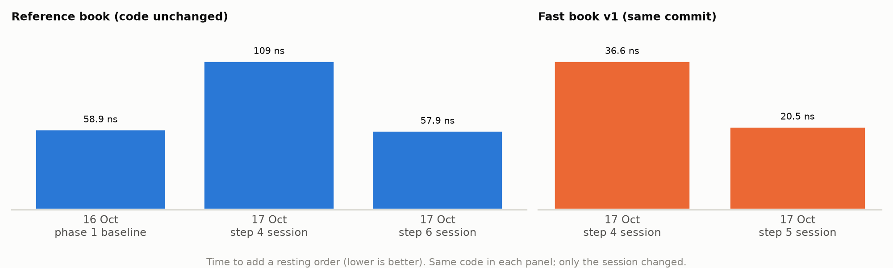
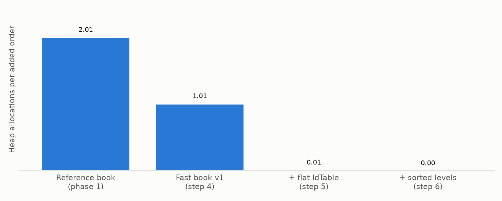
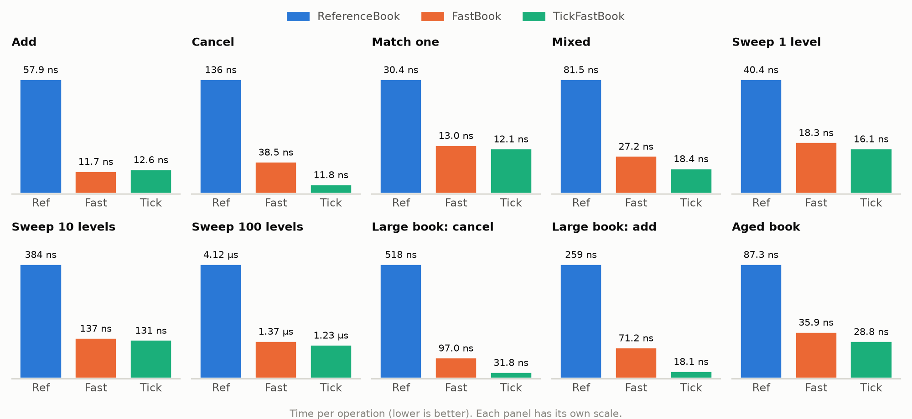
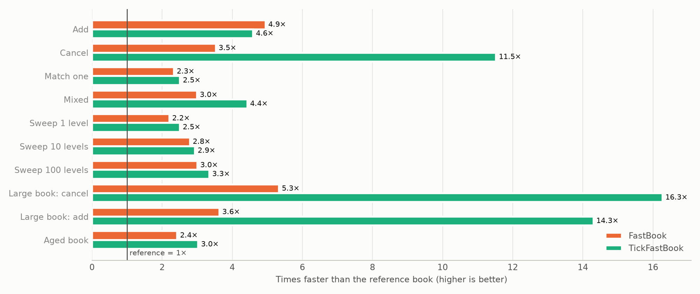
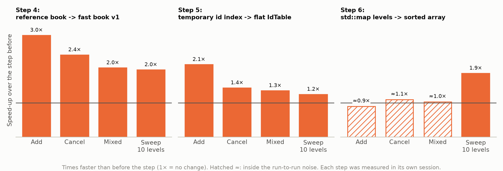
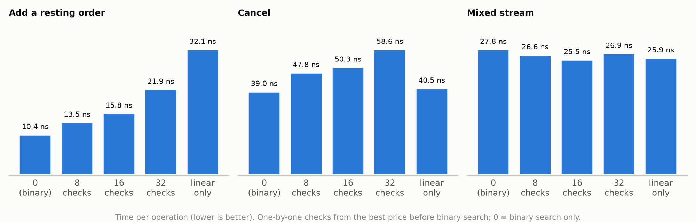
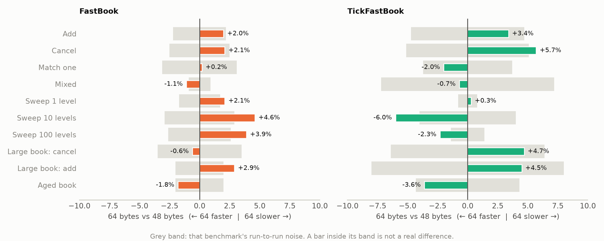

# NanoBook: Phase 2 Report

**The fast book** · 18 October 2026 · C++23, GCC 14 / Clang 18, Linux · Phase 2 complete

---

## 1. Summary

Phase 2 builds a second order book, `FastBook`, with **exactly the same behaviour** as the phase 1
reference book but built for speed: no heap allocation while trading, and data laid out so the CPU
cache can do its job. The reference book stays unchanged as the answer key.

| | |
|---|---|
| Status | **Complete.** All 8 steps done, and both exit criteria met (§6.5). |
| Allocations per added order | **2.01 → 0** (reference book → fast book) |
| Zero-allocation test, whole fast book | **Passes**: 100,000 random operations after a warm-up, exactly 0 allocations (exit criterion 2) |
| Speed (same session) | **2.2–5.3× faster** than the reference book on every benchmark; the tick-array experiment up to 16× on a large book |
| Correctness | All **96 book and exchange tests** run on both fast-book variants; in the exit check the differential fuzzer agreed with the reference book on **162 million** random operations (exit criterion 1) |
| Tests | **373** in Release builds (362 with sanitizers), on GCC and Clang |
| Planted bugs | **12** deliberate bugs across the new code, every one caught |
| Design decisions | **17** recorded (§5): 7 decided by a measurement, 8 by reasoning, 2 still open |

How to read this report: §3–§4 show what the fast book is made of, §5 explains **why each piece won
over the alternatives**, §6 how it was proven correct (every test suite), and §7 every benchmark
and experiment, with charts.

---

## 2. The plan and where it stands

| Step | What | Status |
|---|---|---|
| 0 | Design note (`docs/fast-book-design.md`) | ✓ Done |
| 1 | Zero-allocation test tool (a counting `operator new`) | ✓ Done |
| 2 | Differential fuzzer (`tools/nanobook_fuzz`) | ✓ Done |
| 3 | Order pool and intrusive queue, with unit tests | ✓ Done |
| 4 | Fast book v1: correct first, with temporary parts | ✓ Done |
| 5 | Flat hash table (`IdTable`) replaces the temporary id lookup | ✓ Done |
| 6 | Price levels: sorted array (main) and tick array (experiment) | ✓ Done |
| 7 | Order layout: 48 vs 64 bytes per order, measured (48 kept) | ✓ Done |
| 8 | Exit check: 10⁷+ fuzz on several seeds, zero-allocation test, this report | ✓ Done |

The method throughout: build each part on its own with its own tests, put it into the book while
everything else stays the same, check it with the fuzzer, then measure before against after in one
session. A failure then always points at the one part that just changed.

```
step 4:  ReferenceBook ──► FastBook v1 = pool + queues + [tmp unordered_map] + [tmp std::map]
step 5:                    FastBook    = pool + queues +  IdTable           + [tmp std::map]
step 6:                    FastBook    = pool + queues +  IdTable           +  SortedLevels
                       TickFastBook    = pool + queues +  IdTable           +  TickLevels
([tmp] = a temporary standard-library part, replaced one step later)
step 7:                    order slot 48 vs 64 bytes measured; 48 kept
```

---

## 3. What the fast book is made of

```
                 Cancel #7                 New order at $10.00
                    │                              │
                    ▼                              ▼
   ┌──────────────────────────┐       ┌───────────────────────────┐
   │ IdTable (flat hash table)│       │ Levels: SortedLevels       │
   │  #7 → slot 3             │       │  (or TickLevels)           │
   └────────────┬─────────────┘       │  $10.00 → its Level        │
                │                     └─────────────┬─────────────┘
                ▼                                   ▼
   ┌──────────────────────────────────────────────────────────────┐
   │ OrderPool: max_orders slots, allocated once                   │
   │  slot 0 [#1 Alice] ◄─► slot 1 [#3 Bob]     ← $10.00's queue     │
   │  slot 2 [free] → slot 4 [free] → …          ← free list         │
   └──────────────────────────────────────────────────────────────┘
```

| Part | File | Data structure | Key operations and cost |
|---|---|---|---|
| Order slot | `fast/order.hpp` | 48-byte struct; links are `uint32_t` slot numbers, not pointers | — |
| Order pool | `fast/order_pool.hpp` | One array of `max_orders` slots + a **free list** threaded through the empty slots | take / give back a slot: **O(1)**, no allocation |
| Price-level queue | `fast/intrusive_queue.hpp` | **Intrusive doubly linked list**: the links live inside the orders; the queue keeps first, last, count (12 bytes) | add at back, remove from anywhere: **O(1)** |
| Level | `fast/level.hpp` | price + **cached total quantity** + queue (32 bytes) | level quantity: **O(1)** (no walk) |
| Id lookup | `fast/id_table.hpp` | **Open-addressing hash table**, Fibonacci hashing, linear probing, **backward-shift deletion**, ≥ 2× `max_orders` entries | find / insert / erase: **O(1)** expected, usually 1–2 reads |
| Price levels (main) | `fast/sorted_levels.hpp` | **Sorted array per side, best price at the end** | best: **O(1)**; find a price: **binary search O(log n)**; add/remove near best: few moves |
| Price levels (experiment) | `fast/tick_levels.hpp` | **Tick array** (one slot per price) + **two-level bitmap** | find a price: **O(1)**; next price: 64 at a time with `countr_zero` |
| The book | `fast/fast_book.hpp` | `BasicFastBook<Levels>`, a template over the level structure | matching, cancel, modify: same rules as the reference book |

---

## 4. The data structures, one by one

### 4.1 Order pool and free list (step 3)

Like a car park with numbered spaces: every space is built once, at start-up, and orders take and
return them.

```
start:        slot 0 → 1 → 2 → 3 → end          (free list; first orders sit side by side)
take 2:       [Alice] [Bob]  free: 2 → 3 → end
give back 0:  [free]  [Bob]  free: 0 → 2 → 3    (released last = reused first: still in cache)
```

- The free list costs no memory: it runs through the empty slots' own `next` field.
- A full pool is the contract's `BookFull`: no new behaviour.
- A free slot holds a special tag in `prev`, so Debug builds catch a slot released twice.

### 4.2 Intrusive queue (step 3)

Each price level's first-come-first-served line. The orders carry their own links; the level only
remembers who is first and last.

```
level $10.00: first=0, last=1, count=2
   slot 0 Alice  (prev: none, next: 1)  ◄──►  slot 1 Bob  (prev: 0, next: none)
cancel Alice → the level's first becomes 1, Bob's prev becomes none. Two updates.
```

### 4.3 Flat hash table, `IdTable` (step 5)

Answers "which slot holds order #N?". A row of lockers, at least twice as many as orders.

| Idea | What it does |
|---|---|
| Fibonacci hashing | home locker = (id × 11400714819323198485) keeping the top bits: spreads near-sequential exchange ids apart |
| Linear probing | home taken → try the next locker, wrapping at the end |
| Backward-shift deletion | after removing, later entries slide back into the hole **unless their home is after the hole**, so a search can never stop early at a gap |
| id 0 = empty | the exchange never issues id 0 |

Worked example (8 lockers, real hash values): ids #1, #9 and #17 all hash to locker 4.

```
after inserts:   locker 4: #1   5: #9   6: #3 (home 6)   7: #17
erase #9:        hole at 5 → #3 stays (home 6 is after the hole) → #17 slides to 5
result:          locker 4: #1   5: #17  6: #3            7: empty
without the slide, a search for #17 would stop at the empty locker 5 and wrongly answer "not here"
```

### 4.4 Price levels: sorted array, binary search (step 6, the main design)

```
bids (best at the end):   [ 990 | 998 | 1000 | 1001 ]      best bid = last element, O(1)
find 1000:  binary search: check the middle, keep the half it's in (about 7 looks for 100 levels)
new best 1002:  goes at the end, nothing moves
new deepest 980: goes at the front, every level shifts by one (rare, but slow in a deep book)
```

- Memory follows the number of levels in use, not the price band: any band works.
- Both arrays are reserved for `max_orders` levels at start-up, so they never grow while trading.

### 4.5 Price levels: tick array with a bitmap (step 6, the experiment)

```
band $9.90–$10.10:   slot = price − 990       (finding a level never searches)
bitmap:   bit per price, 1 = level exists      best bid = highest set bit (one CPU instruction)
summary:  bit per 64-price block                skips whole empty stretches
```

- Memory follows the **band width**: 64 KB per side for a $100 stock at ±10%, about 450 MB for
  BRK.A. So it accepts narrow bands only (≤ 65,536 ticks) and stays an experiment.

---

## 5. Design decisions: why each piece won

Every choice in the fast book had alternatives. This section lists them, says which won and **how
it was decided**:

- **Measured**: a same-session before/after benchmark decided it (§7).
- **Reasoned**: decided by arithmetic or by how the hardware works, without a benchmark. Each is a
  candidate for re-measuring if phase 3's tail latency points at it.
- **Open**: marked `[MEASURE]` in the design note and not yet measured.

### 5.1 The decision matrix

| # | Decision | Chosen | Alternatives | Basis | Evidence |
|---|---|---|---|---|---|
| 1 | Where orders live | Pool of slots + free list | A `std::list` node per order (reference book) | **Measured** | Step 4: allocations per add 2.01 → 1.01, add 3.0× faster (§5.2) |
| 2 | Time-priority queue | Intrusive linked list | `std::list` per level | **Measured** (with #1) | Step 4, same numbers: the two changed together |
| 3 | Level quantity | Cached `total` per level | Walk the queue and add up | Reasoned | O(1) instead of O(orders); invariant 3 checks it |
| 4 | Links | `uint32_t` slot numbers | 8-byte pointers | Reasoned | Half the size; stay valid if storage moves |
| 5 | Free-slot reuse | Last freed, first reused | First freed, first reused | Reasoned | The slot just freed is probably still in cache |
| 6 | Id → slot lookup | Flat `IdTable` | `std::unordered_map`, `std::map`, direct table, the exchange's table | **Measured** | Step 5: add 2.1×, cancel 1.4×, allocations 1.01 → 0.01 (§5.3) |
| 7 | Hash formula | Fibonacci (multiply) | `id % size` | Reasoned | Near-sequential ids would pile into neighbouring lockers |
| 8 | Collisions | Linear probing | Chaining (a list per bucket) | Reasoned | No allocation; the next locker is usually in the same cache line |
| 9 | Deletion | Backward shift | Tombstones ("deleted" markers) | Reasoned + tested | No marker build-up over a day of cancels; 2 planted bugs caught (§6.4) |
| 10 | Hash entry size | 16 bytes (`id` + `slot` + padding) | 12-byte packed; slot only | **Open** | `[MEASURE]` in design §5.1, not yet run |
| 11 | Price levels (default) | `SortedLevels` | `std::map`, `TickLevels`, moving window | **Measured** | Step 6: sweeps 1.7–1.9×, last allocations gone (§5.4) |
| 12 | Best price position | End of the array | Start of the array | Reasoned | Most activity is near the best price, and the end shifts least |
| 13 | Search in sorted levels | Plain binary search | Hybrid (K one-by-one checks, then binary), linear | **Measured** | Binary fastest on add and cancel; mixed all within 9% (§7.7) |
| 14 | Tick array | Experiment only; moving window in phase 6 | Make it the default | **Measured** | 3–4× faster on lookups, but memory follows the band width (§5.4) |
| 15 | Order slot size | 48 bytes, packed | 64 bytes, one cache line each | **Measured** | No case for 64: all within ±6%, never clearly better (§7.8) |
| 16 | Two level structures | Template `BasicFastBook<Levels>` | Virtual interface; two copies of the book | Reasoned | No indirect call on the hot path; one copy of the matching code |
| 17 | Deep-insert weakness | Accepted for now | Circular array, chunked array, moving window | **Open** | Needs phase 3's p99 / p99.9 (§5.5) |

The open list also has two smaller items, both in the design note: reusing the exchange's id table
(§5.3 below, an experiment never run) and caching per-level totals that exclude self-match
candidates for FOK (design §7, "probably not").

### 5.2 Where orders live: pool vs `std::list` nodes (decisions 1–5)

The reference book stores each order in a `std::list` node: one `new` when it rests, one `delete`
when it leaves. Each `new` is a trip into the memory allocator, and the nodes end up wherever the
allocator put them.

| | List node (reference book) | Pool slot + intrusive links (fast book) |
|---|---|---|
| Memory request per order | 1 `new` + 1 `delete` | **0** (all slots made at start-up) |
| Where orders sit in memory | Wherever the allocator put them | One array, side by side |
| Unlink from the middle | O(1), plus freeing the node | O(1): two link updates |
| Size of a link | 8-byte pointer | 4-byte slot number |
| Full book | Grows until memory runs out | `BookFull`, which the contract already rejects |

Measured in step 4, together with the cached totals (they arrived in one step, so their effects
can't be separated): **allocations per add 2.01 → 1.01, add 3.0×, cancel 2.4×, match one 2.5×
faster** (§7.6). The one allocation left was the temporary id index, removed in step 5.

### 5.3 The id lookup: why a flat hash table (decisions 6–10)

A cancel names an order by id; the book needs its slot. Five ways were considered:

| Option | Steps per lookup | Memory | Allocation | Verdict |
|---|---|---|---|---|
| `std::map` (reference book) | ~log₂(n) node hops, each somewhere else in memory | 1 node per order | 1 per order | Too slow: the reference book's cancel was its slowest operation |
| `std::unordered_map` (step 4, temporary) | Hash, then follow a pointer to a node | 1 node per order + buckets | 1 per order | **Replaced in step 5**: add 2.1×, cancel 1.4× |
| **`IdTable` (chosen)** | Usually 1–2 reads in one array | 2 × `max_orders` (power of two) × 16 B: 32 MB for 1M orders | **0** | Kept |
| Direct table (entry number = id) | 1 read | One entry for **every id of the day**, in every book | 0 | Rejected: ids are exchange-wide, 8,000 symbols × hundreds of millions of entries |
| Reuse the exchange's id table | 1 read | ~8 bytes per order of the day: 800 MB for 100M | 0 | Experiment only, not run: it reverses the exchange's cold-path design and ties books to the exchange |

Inside the table, three smaller choices, each reasoned:
- **Fibonacci hashing, not `id % size`.** Exchange ids come in near-sequential runs. With `% size`,
  ids 100, 101, 102 … fill lockers 100, 101, 102 … in one solid block, and with linear probing any
  other id whose home falls inside that block has to walk to its end. Multiplying by
  11400714819323198485 and keeping the top bits scatters them, for the cost of one multiply.
- **Linear probing, not chaining.** Chaining keeps a list per bucket, which needs allocation.
  Probing just looks at the next locker, usually in the same 64-byte cache line (4 entries per
  line).
- **Backward shift, not tombstones.** A tombstone ("deleted here, keep searching") is simpler, but
  after a day of cancels the table fills with them and every search gets longer. Backward shift
  keeps the table as if the erased id was never inserted. Its subtle rule ("don't move an entry
  whose home is after the hole") is the one two planted bugs targeted, and both were caught.

**Still open:** the entry is 16 bytes (an 8-byte id, a 4-byte slot, 4 bytes of padding). A 12-byte
packed entry fits a third more per cache line; storing only the slot and reading the id from the
pool saves more, but costs an extra memory read per probe. Not yet measured.

### 5.4 Price levels: sorted array vs tree vs tick array (decisions 11–14)

| Option | Find a price | Best price | Memory grows with | Any price band? | Verdict |
|---|---|---|---|---|---|
| `std::map` (reference; temporary in steps 4–5) | ~log₂(levels) node hops | O(1) (cached end) | Levels; 1 allocation each | Yes | **Replaced in step 6** |
| **`SortedLevels` (chosen)** | Binary search in one array | O(1): last element | Levels in use | **Yes** | `FastBook` default |
| `TickLevels` (experiment) | **O(1)**: one index | Bitmap: `countr_zero` / `countl_zero` | **Band width** | No: ≤ 65,536 ticks | `TickFastBook` only |
| Moving window | O(1) near the best, sorted list beyond | Bitmap | A fixed window + levels outside it | Yes | Planned for phase 6 |

What the measurements said (§7.5, §7.6):
- **Sorted array vs `std::map`** (step 6): sweeps **1.7× / 1.9× / 1.8×** faster for 1 / 10 / 100
  levels (no tree node freed per emptied level), and allocations per mixed operation 0.053 → **0**.
  Add, cancel and the mixed stream were inside the noise: a 100-level tree stays in cache.
- **Tick array vs sorted array** (same session): **3.3× faster cancel, 3.1× / 3.9× on the large
  book**, 1.5× on the mixed stream, 1.2× on the aged book; within about 10% where no price has to
  be found (add at a known level, match, sweep).
- **Why the tick array isn't the default anyway:** its memory follows the band width. A $100 stock
  at ±10% needs 64 KB per side; BRK.A needs about 450 MB per side. The contract promises any band
  (`docs/design.md` §12), and only the sorted array keeps that promise.
- **What it led to:** the design note's condition for the moving window ("the tick array is
  clearly faster on the realistic benchmarks") is met, so phase 6 builds it: tick-array speed near
  the best price, for any band.

### 5.5 The sorted array's known weakness: deep inserts (decision 17)

```
bids, 5,000 levels at prices 2, 4, 6, …, 10,000, best at the end:
  [ 2 | 4 | 6 | ... | 9,998 | 10,000 ]

new best bid 10,002  →  goes at the end                            0 moves
new bid at 5,001     →  the 2,500 better levels shift right by one   2,500 × 32 B = 80 KB moved
new deepest bid 1    →  all 5,000 levels shift right by one          5,000 × 32 B = 160 KB moved
```

Rare in real trading (new prices mostly appear near the best), but a single deep insert in a deep
book costs microseconds: a tail-latency spike that an average hides. It was found by accident: a
benchmark setup that built 10,000 levels worst-first did about 50 million moves per book and took
minutes. Phase 3 measures how bad it is at p99 / p99.9. Candidate fixes, simplest first, built
only if the numbers say so:
1. **Circular sorted array**: one pre-allocated ring; an insert shifts toward the nearer end, so at
   most half. (`std::deque` was considered and rejected: it allocates a block whenever it grows.)
2. **Chunked array**: levels in fixed-size blocks from a pool; an insert only shifts one block.
3. **Moving window** (§5.4).

### 5.6 Order slot: 48 bytes packed vs 64 bytes padded (decision 15)

A cache line is 64 bytes: the CPU always loads memory in whole lines. At 48 bytes, orders and lines
don't line up:

```
memory:       |—— line 0: bytes 0–63 ——|—— line 1: 64–127 ——|—— line 2: 128–191 ——|
48-byte:      [ order 0: 0–47 ][ order 1: 48–95 ][ order 2: 96–143 ][ order 3: 144–191 ]
               inside line 0     lines 0 + 1       lines 1 + 2        inside line 2
              → 2 of every 4 orders straddle two lines: touching one may load two lines
64-byte:      [ order 0: one line ][ order 1: one line ][ order 2: one line ]
              → every order is exactly one line, but 16 of every 64 bytes are padding
```

| | 48 bytes (packed) | 64 bytes (alignas 64) |
|---|---|---|
| Lines touched per order | 1 or 2 | Always 1 |
| The large book's 100,000 orders | 4.8 MB | 6.4 MB (a third more) |
| Orders that fit in the 30 MiB L3 cache | ~655,000 | ~490,000 |

The bet for 64 bytes: never loading a second line. The bet for 48: more orders per cache. The
measurement (§7.8, every benchmark, both fast books) found **no case for 64 bytes**: every
difference was within ±6%, 12 of the 20 inside the noise, and the 8 beyond it small and pointing
both ways (on `FastBook`, the default, they lean slightly towards 48). So **48 bytes stays**:
simpler and a quarter less memory. The likely reason it didn't matter: even the large
book's 4.8 MB of orders fits in the 30 MB L3 cache, where a second line is cheap. A book too big
for L3, or phase 3's tail latency, is where it could still show.

### 5.7 One book, two level structures: why a template (decision 16)

`BasicFastBook<Levels>` is written once; `FastBook` and `TickFastBook` are the same code with a
different `Levels` plugged in at compile time.
- **Versus a virtual interface** (`Levels*` with virtual functions): every level lookup would be an
  indirect call the compiler can't inline, on the hot path.
- **Versus two copies of the book:** a bug fixed in one could be forgotten in the other, and the
  speed comparison would no longer be like-for-like.
- **Cost:** both variants are compiled (`src/fast/fast_book.cpp` instantiates them explicitly under
  the engine's flags), and error messages mention templates.

---

## 6. How correctness was proven

### 6.1 Four layers of checking

| Layer | What it checks | Scale |
|---|---|---|
| **Typed tests** | Every book and exchange test runs on `ReferenceBook`, `FastBook` and `TickFastBook` | 96 tests × 3 books |
| **Unit tests per part** | Pool, queue, hash table, both level structures, each on its own, including mini differential tests against `std::unordered_map` and `std::map` | 50 tests |
| **Differential fuzzer** | Random steered inputs to the reference book and a fast book; every event compared after every input, the book state every 64 inputs, invariants every 1,024 | 162 million operations in the exit check (§6.5), both variants, including under ASan/UBSan |
| **Zero-allocation tests** | The counting `operator new`, checked in both directions, then the whole fast book: 100,000 operations after warm-up | Exactly 0 allocations |

### 6.2 Every test suite

Counts from `--gtest_list_tests` on the final code. `× 3` means the suite runs once per book.

| Suite | Tests | What it covers |
|---|---|---|
| `BookTest` | 70 × 3 | The contract: matching (price-time priority, partial fills, sweeps), cancel, validation, market, IOC, FOK, self-match prevention, modify (keep or lose priority, total-quantity rule, crossing modifies) |
| `BookCapacityTest` | 9 × 3 | A full book: which orders are still accepted, cancel frees a slot, huge quantities can't overflow, the worst-case event count fits the buffer |
| `ExchangeTest` | 16 × 3 | Exchange-wide ids, separate books per symbol, too-late and unknown cancels and modifies |
| `ExchangeCapacityTest` | 1 × 3 | The exchange running out of ids |
| `ExchangeConfigTest` | 2 | Config validity; the buffer fits the biggest book |
| `Types`, `BookConfig`, `Event` | 5 + 3 + 3 | Strong types, config checks, event construction and equality |
| `OrderPool` (+ death test) | 7 + 1 | Slots handed out in order, full pool, last released reused first, a double release caught in Debug |
| `QueueTest` | 12 | Push, unlink the only / front / back / middle order, pop until empty, move to back, two queues in one pool, the link checker catches a broken link |
| `IdTable` | 11 | Collision runs, erase from the start / middle of a run, a run that wraps around the end, the "home after the hole" rule, ids a table-size apart, agreement with `std::unordered_map` on random operations |
| `LevelsTest` | 8 × 2 | Both level structures: best bid and ask, insert at the best end / deep end / middle, erase, the walk, agreement with `std::map` on random operations |
| `TickLevels` | 3 | Band edges, jumping across empty 64-price blocks, emptying the last level |
| `Fuzz` | 11 | The fuzzer itself: no false alarms (reference vs reference), both fast books agree, it catches wrong events and wrong state, the report ends with a replay command, seeds replay exactly, it covers the interesting cases |
| **`nanobook_tests` total** | **362** | Runs in all 4 presets, including ASan/UBSan |
| `AllocCounter` | 5 | The counter counts `new`, `new[]`, vector growth, every allocation, and 0 for none |
| `ZeroAlloc` | 6 | `EventBuffer`, pool + queues, `IdTable`, `FastBook` and `TickFastBook` never allocate after start-up; the reference book does (proves the test can fail) |
| **Grand total (Release)** | **373** | The allocation tests are Release-only: ASan replaces `operator new` itself |

### 6.3 The differential fuzzer

```
          seed ─► steered random inputs ─┬─► ReferenceBook ─► events A ─┐
                                         │                              ├─► equal after EVERY input?
                                         └─► FastBook ──────► events B ─┘    + state every 64 inputs
first difference ─► report: seed, step, both event lists, the 20 inputs before it, replay command
```

Steered so the interesting cases are common: prices around a drifting middle, cancels and modifies
that mostly hit resting orders, four owners (self-matches), every order type, edge values, and a
tiny 16-order book for a quarter of the seeds.

Its own design choices:
- **`rng() % n`, not `std::uniform_int_distribution`.** The C++ standard fixes `mt19937_64`'s
  output exactly, but not how a distribution uses it. Taking the numbers straight from the
  generator makes a seed replay identically with GCC's and Clang's standard libraries.
- **State every 64 inputs, invariants every 1,024.** Comparing the full state is far more work
  than comparing events (it reads every level and every resting id), so it runs every 64 inputs;
  events are still compared after every input, and drifted state is found within 64 steps.
- **Proven before use:** reference vs reference must pass, and a deliberately broken book must
  fail (§6.4, the first two rows).

### 6.4 Planted bugs: do the tests have teeth?

| Part | Planted bug | Caught by |
|---|---|---|
| Fuzzer | A book that drops an IOC's closing cancel | Fuzzer, step 11: "events differ" |
| Fuzzer | A book that reports a level quantity one too high | Fuzzer state check, step 64 |
| Allocation counter | Never counts | 5 tests |
| `EventBuffer` | `clear()` reallocates | Zero-allocation test |
| Pool | The same slot handed out twice | 2 tests, plus the double-free check |
| Queue | Unlinking forgets a back link | 5 tests |
| Fast book | A partial fill doesn't lower the level's cached total | 18 tests; fuzzer step 64 |
| Fast book | A modify that loses priority doesn't update `filled` | **1 test only; fuzzer step 561,789** |
| `IdTable` | Erase without backward shift | 5 tests; fuzzer step 17,866 |
| `IdTable` | Shift ignores homes | 2 tests; fuzzer invariant check, step 2,048 |
| Sorted levels | The search returns one position too early | 14 tests; crash in Release, assert names the line in Debug |
| Tick levels | Summary bitmap never cleared | 3 tests; crash in Release |

The `filled` bug is the lesson of the phase: one test caught it, and the fuzzer needed 561,789
inputs. Either safety net alone could have missed it.

### 6.5 The exit check (step 8)

Phase 2's two exit criteria (README roadmap), run on the final code (commit `8e60edf`). The full
output, with every command, is in `docs/data/phase2_exit_check.txt`.

| Exit criterion | Run | Operations | Result |
|---|---|---|---|
| **1. Differential fuzzer passes 10⁷+ operations** | `FastBook`, seeds 1–5, normal book sizes | 5 × 10,000,000 | ✓ PASS |
| | `FastBook`, seeds 101–103, tiny 16-order book | 3 × 10,000,000 | ✓ PASS |
| | `TickFastBook`, seeds 1–5, normal book sizes | 5 × 10,000,000 | ✓ PASS |
| | `TickFastBook`, seeds 101–103, tiny 16-order book | 3 × 10,000,000 | ✓ PASS |
| | Both books under ASan + UBSan, seed 7 | 2 × 1,000,000 | ✓ PASS, no memory errors |
| **2. Zero allocations while trading** | `nanobook_alloc_tests`: the counter checked both ways, then the whole `FastBook` and `TickFastBook` (100,000 random operations after a warm-up) | | ✓ 11 of 11 pass, exactly 0 allocations |

**162 million random operations, zero differences from the reference book.** The final code also
passes all 373 tests on GCC and Clang (362 under the sanitizers), the format check and clang-tidy.

---

## 7. Performance

All numbers: Intel Core i7-14650HX, WSL2, GCC 14 `-O3`, pinned to one core. **For comparison only,
never for publishing** (rule 20). Google Benchmark reports averages; tail latency comes in phase 3.
Full details, with every raw table: `docs/perf-log.md`.

### 7.1 How the measuring was done

This laptop's speed drifts from session to session, so **numbers from different sessions can't be
compared**. The chart shows the same code timed in different sessions:



A 1.9× swing with no code change is bigger than most of the effects being measured. So every
comparison in this report was made like this:

```
before commit ──git worktree──► build A ──┐
after commit  ────────────────► build B ──┤     one session, idle laptop, pinned: taskset -c 2
                                          ▼
round 1:   A: bench 1, bench 2, …     B: bench 1, bench 2, …
round 2:   A: bench 1, bench 2, …     B: bench 1, bench 2, …
           each benchmark its own process: stdbuf -oL (line-buffered), timeout 300 s, 3 repetitions
                                          ▼
per row:   median of the 3 repetitions → average of the 2 rounds
noise:     how far the two rounds differ; a change smaller than that isn't counted as real
```

| Rule | Why (what went wrong without it) |
|---|---|
| Both builds in one session | The unchanged reference book measured 1.6–1.9× slower on 17 Oct than on 16 Oct |
| Two rounds | A single round can't show its own noise; in step 6 the "before" build's two rounds differed by up to 37% on some rows |
| One process per benchmark, line-buffered, 5-minute timeout | The machine slowed 5× mid-run once; a 30-minute timeout killed the run and its buffered output was lost |
| Fixed number of iterations for the sweep, large and aged benchmarks | Google Benchmark picks the count by itself; with ~2 µs of timed work per sweep batch it rebuilt the book hundreds of thousands of times (untimed but slow) and hit the timeout |
| Untimed setup must be cheap too | Building 10,000 levels worst-first took minutes (now best-first: same book) |
| Idle machine | A step 7 run was thrown away because the laptop was in use; Windows can schedule other work on the pinned core |

Step 5 used the same idea with an earlier form of the script (one process, 5 repetitions); one
process per benchmark was added in step 6.

### 7.2 Every benchmark

All in `bench/bench_book.cpp`, each a template run on all three books. A "batch" is 10,000
operations timed together, so the cost of pausing the timer (over 100 ns) disappears.

| Benchmark | What one timed operation is | Setup (untimed) | Why it exists |
|---|---|---|---|
| `BM_AddResting` | Add a buy order that rests | Empty book; orders spread evenly over 100 prices | The most common operation; phase 1 baseline |
| `BM_Cancel` | Cancel a resting order, in shuffled order | 10,000 resting orders | Phase 1's slowest operation: the id lookup and level lookup together |
| `BM_MatchOne` | An order that trades fully with one resting order | 10,000 sells of 1 at one price | Matching cost alone: exactly one New + one Trade |
| `BM_Sweep/1`, `/10`, `/100` | One order sweeping 1, 10 or 100 levels | One order of 1 on each level; 1,000 fixed batches | How cost grows per level emptied |
| `BM_Mixed` | A seeded stream: 60% add, 30% cancel, 10% IOC | Empty book | A rough mix of all operations |
| `BM_LargeCancel` | Cancel a random order of 100,000 | 100,000 orders on 10,000 levels | Bigger than L1 and L2: lookups really go to memory |
| `BM_LargeAdd` | Add at a random one of 10,000 existing levels | Same large book | Finding a level in a big book |
| `BM_Aged` | The next fuzzer-style input on a book that has run for a while | 200,000 random inputs replayed first; 50 timed batches | Memory scattered as after a trading day; a fresh book flatters `std::map` |

Every benchmark also reports **allocations per operation**, from the same counting `operator new`
as the tests.

### 7.3 Allocations: the main goal of phase 2



| Stage | Per added order | Per mixed operation | What was left |
|---|---|---|---|
| Reference book | 2.01 | 1.26 | A `std::list` node + a `std::map` node per order, a `std::map` node per new level |
| Step 4: fast v1 | 1.01 | 0.66 | The temporary `std::unordered_map` node + new levels |
| Step 5: + `IdTable` | 0.01 | 0.05 | Only new `std::map` levels |
| Step 6: + `SortedLevels` | **0** | **0** | Nothing |

### 7.4 Time per operation, all three books (one session)





| Benchmark | Reference | FastBook | TickFastBook | Fast vs reference | Tick vs Fast |
|---|---|---|---|---|---|
| Add a resting order | 57.9 ns | 11.7 ns | 12.6 ns | **4.9×** | 0.9× |
| Cancel | 136.0 ns | 38.5 ns | 11.8 ns | **3.5×** | **3.3×** |
| Match one | 30.4 ns | 13.0 ns | 12.1 ns | 2.3× | 1.1× |
| Mixed stream | 81.5 ns | 27.2 ns | 18.4 ns | **3.0×** | 1.5× |
| Sweep 1 / 10 / 100 levels | 40 / 384 / 4,116 ns | 18 / 137 / 1,368 ns | 16 / 131 / 1,229 ns | 2.2× / 2.8× / 3.0× | 1.1× |
| Large book: cancel | 517.5 ns | 97.0 ns | 31.8 ns | **5.3×** | **3.1×** |
| Large book: add | 258.9 ns | 71.2 ns | 18.1 ns | 3.6× | **3.9×** |
| Aged book | 87.3 ns | 35.9 ns | 28.8 ns | 2.4× | 1.2× |

What the table says:
- **The biggest gains are on the large book** (100,000 orders): too big for the CPU's fastest
  caches (L1 and L2), so the reference book's scattered tree nodes cost real memory trips, while
  the fast book's data sits in a few compact arrays.
- **The tick array wins wherever a price has to be found** (cancel, the large book: 3–4× faster
  than the sorted array), because a level is one array index away instead of a binary search.
  Where no lookup is needed (adding at a known level, matching, sweeping) the two are within ~10%.
- **Add is the one place the tick array isn't faster** (12.6 vs 11.7 ns): with only 100 levels,
  the binary search is a handful of steps on data already in cache, so there's little to save.

### 7.5 Gains at each step (each measured in its own session)



| Step | Before | After | Add | Cancel | Match one | Mixed | Sweep 10 | Allocations per add |
|---|---|---|---|---|---|---|---|---|
| 4 | Reference book | Fast v1 (pool, queues, cached totals) | 3.0× | 2.4× | 2.5× | ~2.0× ⚠ | ~2.0× ⚠ | 2.01 → 1.01 |
| 5 | Temporary `std::unordered_map` lookup | Flat `IdTable` | 2.1× | 1.4× | 1.6× | 1.3× | 1.2× | 1.01 → 0.01 |
| 6 | Temporary `std::map` levels | Sorted array | ≈ same | ≈ same | inconclusive | ≈ same | **1.9×** | 0.01 → **0** |

⚠ these rows varied 19% run to run in that session; the 2× change is well beyond that, but the exact
figure isn't reliable. Step 6's speed gain was on sweeps (1.7× / 1.9× / 1.8× for 1 / 10 / 100
levels); its main purpose, removing the last allocations, is in §7.3. Ratios from different
sessions can't be multiplied into one overall number on this machine (§7.1); §7.4 is the
like-for-like comparison.

### 7.6 Step-by-step raw numbers

The times behind §7.5, for the benchmarks shown in the chart (each step its own session, so compare
only within a row):

| Step | Benchmark | Before | After |
|---|---|---|---|
| 4 | Add / Cancel / Mixed / Sweep 10 | 108.8 / 239.2 / 97.8 / 674.9 ns | 36.6 / 99.8 / 48.5 / 344.3 ns |
| 5 | Add / Cancel / Mixed / Sweep 10 | 20.5 / 53.6 / 38.0 / 280.5 ns | 9.7 / 37.5 / 28.2 / 226.2 ns |
| 6 | Add / Cancel / Mixed / Sweep 10 | 10.5 / 42.2 / 28.0 / 255.2 ns | 11.7 / 38.5 / 27.2 / 137.3 ns |

### 7.7 Experiment: the search inside the sorted levels (hybrid measured and dropped)

The design planned a hybrid: check the K levels nearest the best price one by one, then switch to
binary search, betting that most lookups land near the best price. Measured in one session with
K = 0 (binary only), 8, 16 and 32, and a plain linear scan:



| Benchmark | Binary only | K = 8 | K = 16 | K = 32 | Linear only |
|---|---|---|---|---|---|
| Add a resting order | **10.4 ns** | 13.5 ns | 15.8 ns | 21.9 ns | 32.1 ns |
| Cancel | **39.0 ns** | 47.8 ns | 50.3 ns | 58.6 ns | 40.5 ns |
| Mixed stream | 27.8 ns | 26.6 ns | 25.5 ns | 26.9 ns | 25.9 ns |

Why binary won: add and cancel spread evenly over 100 levels, so a target is rarely in the first K;
the one-by-one checks are wasted work before the binary search runs anyway. The mixed stream does
cluster near the middle, and there all five are within about 9%, inside the noise. **Verdict: plain
binary search** (simpler, never worse). Real Nasdaq flow may cluster more tightly near the best
price, so this is on the design note's revisit list for phase 4 (`docs/fast-book-design.md` §13).

### 7.8 Experiment: order slot 48 vs 64 bytes (step 7)

The 64-byte variant was a two-line patch (`struct alignas(64) Order` and its `static_assert`),
built in a temporary worktree and never committed. Before timing it passed all 373 tests and 12
million fuzz operations, so both variants were known to be correct. Then both builds ran by the
§7.1 method on an idle machine: both fast books, all 10 benchmarks.



| Benchmark | FastBook 48 B | FastBook 64 B | Change | Noise | Tick 48 B | Tick 64 B | Change | Noise |
|---|---|---|---|---|---|---|---|---|
| Add | 11.9 ns | 12.2 ns | +2.0% | 2.2% | 12.2 ns | 12.7 ns | +3.4% | 4.7% |
| Cancel | 38.8 ns | 39.6 ns | +2.1% | 2.5% | 12.0 ns | 12.7 ns | +5.7% | 5.1% |
| Match one | 13.1 ns | 13.2 ns | +0.2% | 3.1% | 12.5 ns | 12.2 ns | −2.0% | 3.7% |
| Mixed | 27.7 ns | 27.4 ns | −1.1% | 0.9% | 18.0 ns | 17.9 ns | −0.7% | 7.2% |
| Sweep 1 level | 18.7 ns | 19.1 ns ¹ | +2.1% | 1.7% | 15.9 ns | 15.9 ns | +0.3% | 0.8% |
| Sweep 10 levels | 139.7 ns | 146.1 ns | **+4.6%** | 2.9% | 130.6 ns | 122.8 ns | **−6.0%** | 4.0% |
| Sweep 100 levels | 1.36 µs | 1.42 µs | **+3.9%** | 2.6% | 1.20 µs | 1.17 µs | −2.3% | 1.4% |
| Large book: cancel | 95.0 ns | 94.4 ns | −0.6% | 3.5% | 29.1 ns | 30.5 ns | +4.7% | 6.4% |
| Large book: add | 69.3 ns | 71.4 ns | +2.9% | 2.0% | 17.1 ns | 17.9 ns | +4.5% | 8.0% |
| Aged book | 33.0 ns | 32.4 ns | −1.8% | 2.0% | 26.8 ns | 25.8 ns | −3.6% | 4.3% |

Positive = 64 bytes slower. ¹ one round only: round 2 hit the 5-minute limit, which is what led to
the fixed sweep iterations (§7.1).

How to read it:
- **A change inside its noise band isn't a result.** 12 of the 20 rows are.
- **The 8 beyond it are all small (1–6%) and split 5 to 3.** On `FastBook`, the default, 4 of its 5
  say 64 bytes is slower (sweeps 10 and 100 by 4–5%, sweep 1 and large-book add by 2–3%); only the
  mixed stream (−1.1%) goes the other way. On `TickFastBook` they disagree: cancel +5.7%, but sweeps
  10 and 100 −6.0% and −2.3%.
- **The same operation points both ways:** the 10-level sweep is 4.6% slower at 64 bytes on one
  book and 6.0% faster on the other, although both books store orders identically.
- **Verdict: 48 bytes stays** (§5.6). 64 bytes never clearly wins, costs a third more memory, and on
  the default book leans slightly slower. A tie is a result: at this book size, on this machine,
  the cache-line split doesn't matter.

### 7.9 What hasn't been measured yet

| Item | Why not yet | When |
|---|---|---|
| Tail latency (p50 / p99 / p99.9) of every operation | Google Benchmark only gives averages | Phase 3, `rdtsc` harness |
| The sorted array's deep-insert worst case (§5.5) | It only shows in the tail | Phase 3 |
| Hash entry 16 vs 12 bytes (§5.3) | Not run in phase 2 | Phase 3 or 6, with the harness |
| Reusing the exchange's id table (§5.3) | Changes the contract; an experiment only | Only if the id lookup shows up in phase 3 |
| Any number on bare-metal Linux | This machine is WSL2 (rule 20) | Before publishing anything |
| Real order flow | Benchmarks are synthetic | Phase 4, ITCH replay (design §13) |

---

## 8. What phase 2 taught

| Lesson | Where it came from |
|---|---|
| **Build one part at a time** | Every failure pointed at the part just swapped in |
| **Two independent implementations** | The fast book shares no logic with the reference book, so a shared bug can't hide from the fuzzer |
| **Tests and fuzzing need each other** | The `filled` bug: 1 test caught it; the fuzzer took 561,789 inputs |
| **The compiler may delete unused allocations** | Clang counted 1 where 2 were expected; `keep()` fixed the test |
| **Return types: don't make the compiler guess too early** | `auto*` helpers crashed Clang 18 and were refused by GCC |
| **Done means every CI check** | Skipping clang-tidy once turned CI red |
| **Benchmark setup can dominate** | Building a 10,000-level book worst-first took minutes; slow untimed setup also makes runs balloon |
| **Measure in one session, one process per benchmark** | The same code ran 1.9× slower on another day; buffered output was lost when a run was killed |
| **A sorted array has a worst case** | A deep insert shifts every better level: a tail-latency risk for phase 3 |
| **Measure, don't assume** | The hybrid search was a reasonable idea and lost to plain binary search |
| **The fastest structure isn't always the right default** | The tick array won on lookups but can't handle every price band |
| **Benchmark only on an idle machine** | A run was thrown away when the laptop was in use; correctness checks (fuzzing) don't need it idle |
| **A tie is a result** | 48 vs 64 bytes: no consistent winner, so the simpler, smaller layout stays |

---

## 9. What's next

1. **Phase 3, the benchmark harness:** an `rdtsc` timer for every single operation, histograms, and
   p50 / p99 / p99.9 latency, including the sorted array's deep-insert worst case and the open
   items in §7.9. Published numbers need bare-metal Linux (rule 20), not WSL2; dual-booting Ubuntu
   on this laptop is the cheapest way, pinned to a performance core.
2. **Phase 4, ITCH:** replay a real Nasdaq trading day, and re-check the revisit list (design §13)
   with real order flow.
3. **Phase 6:** the moving-window tick array, now justified by the step 6 numbers (§5.4).
