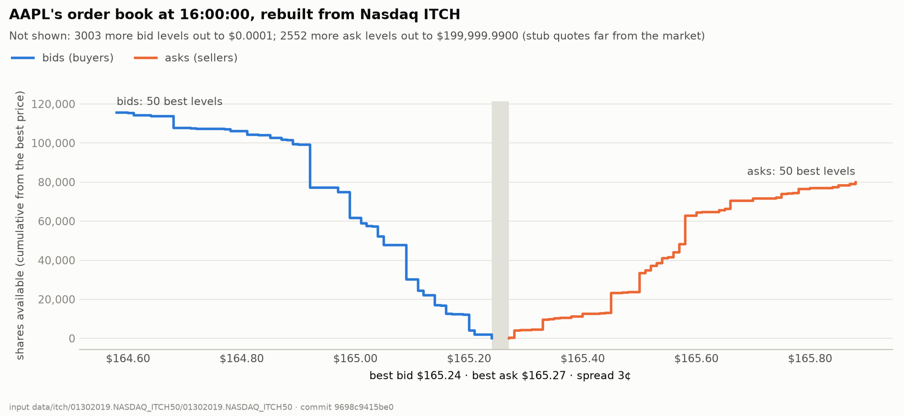
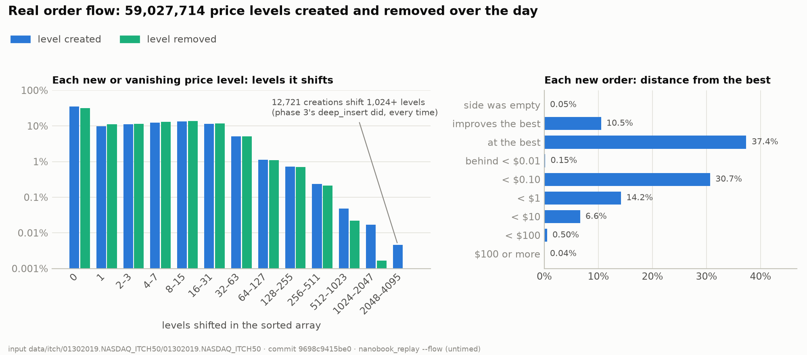
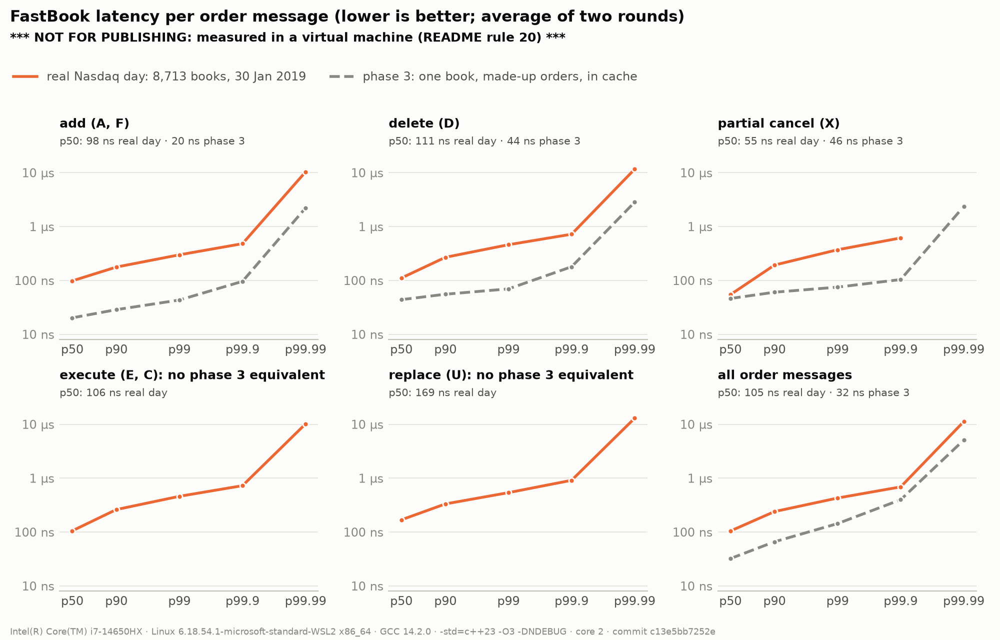

# NanoBook: Phase 4 Report

**Replaying a real Nasdaq day (ITCH 5.0)** · 20 October 2026 · C++23, GCC 14 / Clang 19, Linux · Phase 4 complete except the published (bare-metal) numbers

---

## 1. Summary

Phases 1–3 built **the core of an exchange**: an order book and a matching engine, fed made-up
orders. Phase 4 plays the other side: **a trading firm watching Nasdaq**. It reads one full real
trading day (30 January 2019, 11.25 GB, 368 million messages) and rebuilds every stock's order book
from it, message by message, then measures how fast the book does it.

| | |
|---|---|
| Status | **Complete except step 8**: the exit criteria are met on WSL2; the published numbers come from bare metal, in the same session as phase 3 step 6 (§3) |
| Messages replayed | **368,366,634**, every one accounted for by type |
| Order messages applied | **363,118,215, all accepted**: 0 unknown orders, 0 over-reduced, 0 duplicates, 0 full books |
| Fast book vs reference book | **0 differences** on the whole day: 363 million quick checks, 61,354 full book checks (§6.2) |
| Crossed books | 8, **all while the stock was paused or quotation-only**, never while trading (§6.1) |
| Speed (WSL2, not for publishing) | **104 ns per message** (9.6 million messages/s); the parser is **3%** of that, the book **97%** (§8) |
| Latency per order message | p50 **105 ns**, p99 **429 ns**, p99.9 690 ns (§8.2) |
| Real flow | 0.02% of 59 million new price levels shift 1,024+ levels; 93% of new orders land within $1 of the best price (§7) |
| Tests | **495** in Release builds (479 with sanitizers), on GCC and Clang: **79 new** |
| Planted bugs | **9** deliberate bugs across the new code, every one caught (§6.4) |

How to read this report: §2 explains phase 4 in plain words, §4 what was built, §5 the data, §6 how
it was proven correct, §7 what real order flow looks like, §8 the speed, §9 the decisions and what
changed along the way, §10 the answers to the questions phase 2 left open, and §11 what phase 4
taught.

---

## 2. What phase 4 is, in plain words

An **order book** is the list of orders waiting to trade for one stock: buyers sorted from the
highest price down, sellers from the lowest price up, first come first served at each price. A
**matching engine** decides when two orders trade. Phases 1–3 built both, as an exchange would.

A trading firm doesn't run Nasdaq's matching. It needs to **see** Nasdaq's book to decide its own
trades, and Nasdaq doesn't send a picture of the book: it sends **only the changes**, one message
each, in a feed called **ITCH**: "order 501 added", "30 shares of 501 executed", "501 deleted". The
firm keeps its own copy of every book and applies each change in order; its copy then equals
Nasdaq's book at every moment. That is **rebuilding the book**, and it is phase 4.

Because Nasdaq has already matched, phase 4 never uses NanoBook's matching. It uses **the same
order book** (order pool, price levels, queues, id lookup) with four new, simpler inputs: add
without matching, reduce, remove, replace (§4.2). The design note's §0 has the long version.

---

## 3. The plan and where it stands

| Step | What | Commit |
|---|---|---|
| 0 | Design note (`docs/itch-design.md`), decisions Q1–Q7 | `6ae29c7` |
| 1 | Download the day, confirm the format, count every message type | `a866954` |
| – | Toolchain: Clang 18 → 19 (§9) | `2b85c42` |
| 2 | ITCH parser, test encoder | `d9e422e` |
| 3 | Feed operations on both books | `e4efff3` |
| 4 | Counting pass, sizing, book builder, golden replay, `nanobook_replay`; first full day | `6536828` |
| 5 | Differential replay: reference book vs fast book on the full day | `50d0d03` |
| 6a, 6b | Timing in pre-loaded windows; real-flow analysis | `c13e5bb` |
| 6c | The timed runs | `30b11e1` |
| 7a, 7b | Depth snapshot, charts, this report | `9698c94`, this commit |
| 8 | **Published numbers on bare metal** (with phase 3 step 6) | to do |

The README's exit criteria for phase 4, and where each stands:

| Exit criterion | Status |
|---|---|
| A full-day replay completes | **Met** (§6.1) |
| The consistency checks pass | **Met**: every check, every message (§6.1, §6.2) |
| Messages/sec and per-message latency are reported | **Met on WSL2** (§8); the numbers to publish need bare metal (README rule 20), step 8 |

---

## 4. What was built

### 4.1 The parser (step 2)
`include/nanobook/itch/parser.hpp` walks the file message by message. Each message starts with a
2-byte length; the parser checks it against the spec's length for that message type, then reads
each field at the spec's byte offset. ITCH numbers are big-endian, so each field is read with
`std::memcpy` and `std::byteswap`: on both GCC 14 and Clang 19 that compiles to **one load and one
byte-swap instruction** (checked in the assembly). No `reinterpret_cast` of the buffer (strict
aliasing and alignment UB, README §4). Dispatch is a `switch` on the type letter; the handler is a
template parameter, so no virtual calls (rule 4). Errors are `std::expected`, never exceptions.

### 4.2 The feed operations (step 3)
Both books (reference and fast) gained four inputs, each returning a `FeedResult`:

| Input | ITCH | Does | Fails with (in this order) |
|---|---|---|---|
| `FeedAdd` | A, F | Rest at the back of its price, **never matching**, even if it crosses | InvalidQty, InvalidPrice, DuplicateOrder, BookFull |
| `FeedReduce` | E, C, X | Take shares off, keeping the order's place; remove it at 0 | UnknownOrder, InvalidQty, ReduceTooLarge |
| `FeedRemove` | D | Remove the order | UnknownOrder |
| `FeedReplace` | U | Remove the old order, add the new one on the same side, at the back | UnknownOrder, InvalidQty, InvalidPrice, DuplicateOrder |

Every check comes before any change, so a failed input leaves the book exactly as it was. The
existing matching code compiles to **identical machine code** before and after (checked function by
function), so no phase 2 or 3 number changed.

### 4.3 Counting and sizing (step 4)
Every book reserves all its memory when it is built (rule 1: no allocation while replaying), and
real stocks differ hugely. So a **counting pass** reads the day first and records each stock's peak
number of resting orders and its price range; **sizing** turns that into one `BookConfig` per stock
(125% of the peak plus 16 orders; the price range ±10%; whole-number percentages, because 1.1 has no
exact `double`). The counts are **keyed by stock symbol**, not by Nasdaq's daily locate number, so a
later version can size today's books from **yesterday's** counts, as a real firm must.

### 4.4 The book builder and the tools (steps 4–7)
`BookBuilder` turns each parsed message into a feed input on its stock's book and counts every
message and every result. `nanobook_replay` runs it on a day file:

| Flag | Does |
|---|---|
| (default) | Replay and report: messages by type, every result, the biggest books |
| `--check`, `--structure-every N` | Watch for crossed books; check book structure every N messages |
| `--differential` | Replay into the reference book too and compare (§6.2) |
| `--flow [--csv]` | Count what real flow does to the price levels (§7) |
| `--until HH:MM:SS`, `--symbol`, `--snapshot-csv` | Stop at a time; print or save one stock's book |
| `--throughput`, `--latency`, `--every N` | Timing (§8) |

---

## 5. The data

The day is Nasdaq's public sample `01302019.NASDAQ_ITCH50` (Wednesday 30 January 2019): 4.76 GB
compressed, **11.25 GB** uncompressed, 8,713 stocks. It lives in `data/itch/`, ignored by git (too
big, and not ours to republish).

| Message | Count | Share |
|---|---|---|
| Add (A) | 162,970,455 | 44.2% |
| Delete (D) | 158,273,361 | 43.0% |
| Replace (U) | 27,222,746 | 7.4% |
| Executed (E, C) | 8,255,881 | 2.2% |
| Partial cancel (X) | 4,669,874 | 1.3% |
| Add with attribution (F) | 1,725,898 | 0.5% |
| Everything else | 5,248,419 | 1.4% |

**About 19 deletes for every execution**: real flow is "add, wait, delete"; a trade is rare.

---

## 6. How correctness was proven

### 6.1 The full day with every check (step 4b)
All 363,118,215 order messages applied with no failure of any kind. The book of every stock kept
its structure (3,631 spot checks during the day, 0 failures), and every book ended empty, as
Nasdaq's do (it deletes every remaining order after the close). **Crossed books** (best bid at or
above best ask) happened 8 times, all while the stock was paused (`P`) or in a quotation-only
period (`Q`), never while trading normally (`T`). That decided the rule: a copy may be crossed only
outside `T`; the replay counts crossings while `T` and fails if there are any.

### 6.2 The fast book against the reference book (step 5)
The reference book is written for clarity, the fast book for speed, and they share no code. Step 5
replayed the whole day into both at once and compared them:

| Check | When | Count | Differences |
|---|---|---|---|
| Quick: order count, best prices and their quantities | after every order message | 363,118,215 | **0** |
| Full: every level, every total, every queue's order, every order's shares | the touched stock every million messages; every stock at each market event and at the end | 61,354 | **0** |
| The two builders' statistics | at the end | 1 | **0** |

Phase 2 proved the fast book on 162 million random operations; phase 4 adds a real day.

### 6.3 Tests
| Suite | Tests | What it covers |
|---|---|---|
| `tests/itch/test_parser.cpp` | 13 | Field readers; bytes written by hand from the spec's tables; round trip of every type; broken input |
| `tests/test_feed.cpp` | 40 | 13 rules on each of the 3 books; a 100,000-input differential |
| `tests/itch/test_book_builder.cpp` | 11 | Counting, sizing, and the **golden replay**: a made-up day with every message type, deliberate errors and two crossings, every outcome written out |
| `tests/itch/test_replay_comparison.cpp` | 6 | The comparison catches a different queue order, total or shares; finds the exact first differing message |
| `tests/itch/test_itch_timing.cpp` | 5 | Windows give exactly one parse's result; every Nth message timed and tagged |
| `tests/itch/test_itch_flow.cpp` | 2 | The level-shift query; every count of a hand-worked day |
| `tests/test_alloc.cpp` | +2 | **0 allocations** applying feed inputs, and replaying through parser + builder |

### 6.4 Planted bugs: do the tests have teeth?
| Bug planted | Caught by |
|---|---|
| A field read at the wrong offset (parser) | 2 tests |
| The **same** wrong offset in parser and encoder | **only** the hand-written spec bytes (the round trip passed) |
| Reduce forgets the level's cached total (fast book) | 4 rule tests + the differential |
| Two add checks swapped (fast book) | check-order tests + the differential (input 617) |
| Buy mapped to sell (builder) | the golden replay, on all 3 books |
| The counter never lowers a live count | the counting test |
| A window skips the message cut at its edge | 4 tests |
| An error's offset left relative to its window | the offset test |
| `better_than()` off by one | 2 tests |

---

## 7. What real order flow looks like

At the close the rebuilt AAPL book shows a **3¢ spread** ($165.24 bid, $165.27 ask) with depth
building away from it: what a real book looks like. It also holds **3,053 bid levels down to
$0.0001 and 2,602 ask levels up to $199,999.99**. These are **stub quotes**: market makers must
always show a price, and many park orders where they will never trade.

The flow analysis (`--flow`, untimed) followed every price level the fast book's sorted array
created or removed, and counted the levels each one shifted (the levels better than it, which the
array moves along by one):

- **Most are shallow:** 35% shift nothing, half shift 3 or fewer, 92.8% at most 31.
- **Deep shifts are rare but real:** 12,721 of 59 million creations (0.02%) shift 1,024+ levels,
  the deepest 2,048–4,095. Phase 3's `deep_insert` scenario did that every time: a worst case, not
  typical flow.
- **They add up:** about 40 GB of level copying over the day.
- **New orders cluster near the best:** 48% at or improving it, 93% within $1, 0.54% $10 or more
  away.

**The tick-array book can't hold the real day.** It reserves one slot per possible price between a
stock's lowest and highest order, and stub quotes stretch that from $0.0001 to $200,000: about
**489,000 GB** in all. It stays as the measured upper bound for lookups (3–4× faster than the sorted
array in phase 2) and the starting point for a window design (§10).

---

## 8. Performance

Measured on the same laptop as phases 1–3, **on WSL2, so not for publishing** (rule 20): i7-14650HX,
GCC 14.2.0 `-O3`, pinned to core 2, idle and plugged in, commit `c13e5bb` (clean). The file was
read in 1 GiB windows loaded before the clock started, so the disk is not timed. Two rounds; the
numbers are their average. Full method and data: `docs/perf-log.md`, "A real Nasdaq day through
FastBook".

### 8.1 Throughput

| | ns per message | Messages per second |
|---|---|---|
| Parse only | 3.1 | about 320 M |
| Parse + FastBook | **104.1** | **9.6 M** |
| The book's share | 101.0 | **97%** of the time |

The parser costs about 3 ns per message, the book about 100. Speed work belongs in the book.

### 8.2 Latency per order message

Every 8th order message was timed with phase 3's `rdtsc` timer (45 million samples):

| Kind | p50 | p99 | p99.9 | Phase 3 p50 (one book) |
|---|---|---|---|---|
| add (A, F) | 98.3 ns | 299.7 ns | 482.1 ns | 20.2 ns (`add`) |
| delete (D) | 111.0 ns | 461.1 ns | 722.5 ns | 44.0 ns (`cancel`) |
| partial cancel (X) | 54.5 ns | 371.8 ns | 615.5 ns | 46.3 ns (`modify`) |
| execute (E, C) | 105.6 ns | 461.7 ns | 727.3 ns | – |
| replace (U) | 168.8 ns | 539.9 ns | 915.0 ns | – |
| **all** | **104.8 ns** | **428.6 ns** | 690.3 ns | 32.2 ns (`mixed`) |

### 8.3 What the numbers say
- **The same book is 2.5–5× slower per operation on the real day.** Phase 3 timed one book that
  stayed in the CPU's caches; the real day jumps between 8,713 books far bigger than the 30 MB L3
  cache, and shifts about 40 GB of levels. These are the likely causes, not yet separated: that needs
  hardware counters (`perf`), so bare metal.
- **Timing disturbs memory-bound work more:** the per-message timer adds about 27 ns here against
  6–10 ns in phase 3, because its fences stop the CPU starting the next message's memory reads
  early.
- **p99.99 is about 11 µs**, against phase 3's 2.3 µs floor. Leading hypothesis, not yet tested:
  page faults on the sorted-level arrays, which are reserved but not touched at construction (the
  order pool and id table are). The test is phase 6's: touch them up front and compare.
- **The rounds agree** to 3–5% at p50 and 7–10% at p99, like phase 3. The far tail needs bare
  metal.

---

## 9. Decisions and what changed along the way

| Decision | Choice | Why |
|---|---|---|
| Q1 Which day | 30 Jan 2019 | A full mid-week day, mid-sized among the samples |
| Q2 Feed operations on both books | Yes | So the reference book can check the fast book on real data (§6.2) |
| Q3 Sizing | Counting pre-scan, keyed by symbol | Rule 1 needs sizes up front; stocks differ hugely; ready for "yesterday + margin" |
| Q4 Reading | 1 GiB windows, loaded before timing | The file doesn't fit in WSL2's 15 GB next to the books; the disk stays untimed |
| Q5 Latency samples | **Changed** from "histogram for all" to **every 8th message, raw** | Exact percentiles in 227 MB with phase 3's recorder unchanged; less disturbance |
| Q6 Golden test bytes | Written by a test encoder | Small, readable, none of Nasdaq's data in the repo |
| Q7 Where the file lives | `data/itch/`, downloaded on WSL2 | Work could start before the dual-boot |
| Crossed books | Allowed only outside `T` | Decided from the real day (§6.1) |

Changes forced along the way:
- **Clang 18 → 19.** With GCC 14's standard library, Clang 18 hides `std::expected` (it reports
  C++20 concepts as `201907`; the library wants `202002`). Moving to 19 brought clang-tidy 19's new
  checks, so 27 initializers across the repo now name their fields (`.min_price = ...`); the
  reference book's machine code stayed identical.
- **`invariants_hold()` split.** "Never crossed" is a law for an exchange but not for a copy, so the
  rest of the checks became `structure_holds()`.
- **Only a Stock Directory message creates a stock.** The golden test caught the counting pass
  giving a book to a locate no `R` message named.
- **A `.gitignore` line hid `docs/data/`.** `data/` matched every folder of that name; it is now
  `/data/`.

---

## 10. The questions phase 2 left open (fast-book design §13)

| Question | Answer from the real day | What follows |
|---|---|---|
| Do lookups cluster near the best price more than the benchmarks did? | **Yes:** 48% of new orders at or improving the best, 93% within $1; 35% of new levels are created at the best end of the array | Re-measure the dropped hybrid search (check near the best first) on real flow, phase 6 |
| How wide are real price ranges, and how deep do books get? | **As wide as the spec allows** ($0.0001 to $199,999.99, stub quotes); AAPL peaks at 42,774 resting orders and holds 5,655 levels at the close | A fixed tick array is ruled out (489,000 GB). A **window of tick slots near the best plus an overflow structure** fits the data, phase 6 |
| Are deep inserts rare? | **Rare but real:** 0.02% of level creations shift 1,024+ levels; 40 GB of shifting a day | Pick a fix from fast-book design §6.1, with before/after numbers (rule 10), phase 6 |

---

## 11. What phase 4 taught

1. **A market-data book is mostly add and delete, not matching.** Executions are 2.2% of
   messages; adds and deletes 87%.
2. **One book in cache is not the real cost.** The same code is 2.5–5× slower across 8,713 books.
   Benchmarks that fit in cache flatter a design; the real working set decides.
3. **The parser is cheap; the book is the work** (3 ns against 100 ns).
4. **Real data breaks assumptions synthetic data never tests**: stub quotes made the tick array
   impossible; crossed books happen during pauses; a directory message can be sent twice.
5. **Random testing and real data complement each other.** The fuzzer explores odd cases on
   purpose; the real day brings patterns no generator invented. The fast book passed both.
6. **A test that can't fail proves nothing.** The hand-written spec bytes were the only test to
   catch an offset wrong in both the parser and the encoder.
7. **Measure what you're about to optimise.** The flow analysis showed the deep insert is rare, and
   the tail points at something else (page faults): optimising by guess would have chased the
   wrong thing.

---

## 12. What's next

- **Step 8:** the published numbers, on bare-metal Ubuntu with an isolated core, in the same session
  as phase 3 step 6.
- **Phase 5:** the pipeline: parser, books and publisher on separate threads over SPSC ring
  buffers; the ITCH replay is its natural input.
- **Phase 6 leads, each with before/after numbers:** touch the sorted-level arrays at construction
  (the 11 µs p99.99 hypothesis); the hybrid search near the best; a moving-window tick array; a fix
  for deep inserts; `perf stat` to separate cache misses from shifting.
