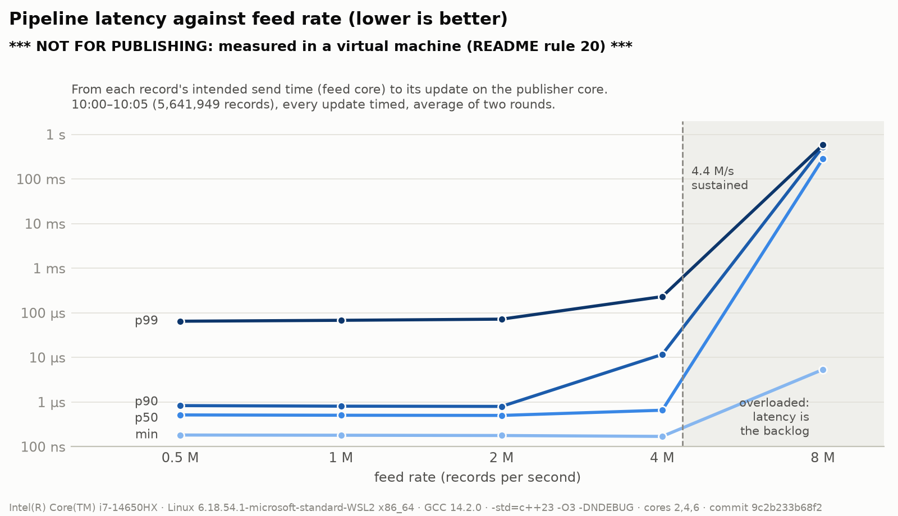
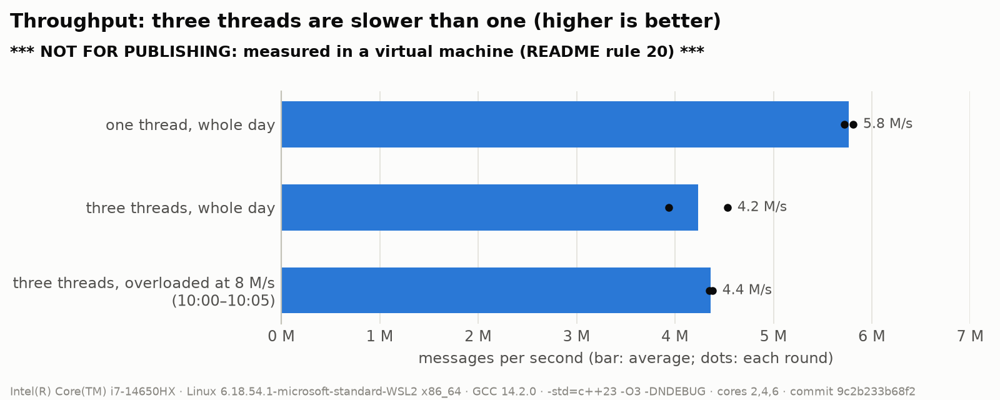

# NanoBook: Phase 5 Report

**The pipeline: three threads over lock-free ring buffers** · 21 October 2026 · C++23, GCC 14 / Clang 19, Linux · Phase 5 complete except the published (bare-metal) numbers

---

## 1. Summary

Phases 1–4 did everything on **one thread**: read a message, apply it to the book, then the next.
Phase 5 splits that work across **three threads on three CPU cores**:
- a **feed** that reads and parses the Nasdaq file;
- an **engine** that keeps the books;
- a **publisher** that logs each book update.

They pass records to each other through **ring buffers that NanoBook writes itself**, with no
locks, made safe by C++ memory ordering alone.

| | |
|---|---|
| Status | **Complete except the published numbers**: both exit criteria are met on WSL2; the numbers to publish come from bare metal, in one session with phases 3 and 4 (§3) |
| Correctness | The full real day through three threads gives a **byte-identical log** to one thread: 363,118,215 updates, 20.3 GB, the same checksum (§6.2) |
| Thread safety | **ThreadSanitizer clean** on GCC and Clang, in CI on every push; it caught a planted ordering bug that every ordinary test missed (§6.4) |
| Allocations | **0** after start-up, on all three threads (§6.3) |
| The ring alone (WSL2, not for publishing) | **5.9 ns per record** (170 M records/s); one hand-over between cores about **90 ns** (§8.1) |
| End-to-end latency, up to 2 M records/s | min **~175 ns**, p50 **~500 ns**, p90 ~0.8 µs, p99 **65–72 µs** (§8.2) |
| Saturation | about **4.4 M records/s**; beyond it, latency is just the backlog (§8.2) |
| One thread against three, whole day | **5.8 M against 4.2 M messages/s: three threads are slower** (§8.3) |
| Tests | **521** in Release builds (503 with sanitizers), on GCC and Clang: **26 new** |
| Planted bugs | **8** deliberate bugs across the new code, every one caught (§6.4) |

How to read this report:
- §2 explains phase 5 in plain words, and §4 what was built.
- §5 covers the memory ordering, and §6 how correctness was proven.
- §7 explains how latency was measured without fooling ourselves, and §8 gives the numbers.
- §9 lists the decisions and what changed along the way, and §10 what phase 5 taught.

---

## 2. What phase 5 is, in plain words

Think of an **assembly line**. One worker who reads each order slip, updates the ledger and files
the receipt does all three in turn. With three workers in a row, the reader is already reading
slip 3 while the bookkeeper updates the ledger for slip 2. Each worker keeps only their own tools
within reach.

| Stage | Core | Job |
|---|---|---|
| **Feed** | A | Read the ITCH file; turn each message the books need into a fixed 48-byte record |
| **Engine** | B | Apply each record to its stock's book (phase 4's book builder, unchanged); say what changed: the stock's new best bid and ask |
| **Publisher** | C | Write each update to a binary log file; measure how long the whole trip took |

Only the engine touches the books, so **the books need no locks at all** (rule 5: one book stays
single-threaded). Real trading systems are built the same way:
- the network handler on one core;
- the book on another;
- the strategy or the publisher on a third.

Between two stages sits a **ring buffer**, a fixed array used in a circle. Picture a sushi
conveyor belt with a fixed number of plates:
- the producer puts plates on at the `head`;
- the consumer takes them off at the `tail`;
- when every plate is full, the producer waits.

Each side only ever writes its own counter, so with exactly one producer and one consumer no lock
is needed. What is needed is a promise about **order**, so the consumer never reads a plate before
the producer has finished filling it (§5).

---

## 3. The plan and where it stands

| Step | What | Commit |
|---|---|---|
| 0 | Design note (`docs/pipeline-design.md`), decisions Q1–Q8 | `37c38a9` |
| 1 | `SpscRing`, its tests, the assembly check, TSan in CI, `nanobook_ringbench` | `42293e3` |
| 2 | Records and the three stages; pipeline = one thread on test days | `2c9ca15` |
| 2 fix | Spin, then yield (CI timed out, §9) | `297d109` |
| 3 | Binary log, `nanobook_logdump`; the full day byte-identical | `c5db172` |
| 4a | Timing modes: throughput, paced latency; `Pacer` | `9c2b233` |
| 4b | The measured session (WSL2) | `db85705` |
| 5 | Charts, this report | this commit |
| – | **Published numbers on bare metal** (with phase 3 step 6 and phase 4 step 8) | to do |

The README's exit criteria for phase 5, and where each stands:

| Exit criterion | Status |
|---|---|
| TSan is clean | **Met**: every test passes under `gcc-tsan` and `clang-tsan`, in CI on every push (§6.4) |
| End-to-end latency percentiles are reported | **Met on WSL2** (§8); the numbers to publish need bare metal (README rule 20) |
| Also required (rules 1, 11): no allocation after start-up; byte-identical output to one thread | **Met** (§6.2, §6.3) |

---

## 4. What was built

### 4.1 The ring buffer (step 1)
`include/nanobook/pipeline/spsc_ring.hpp`: `SpscRing<T, Capacity>`, header-only.
- `head_` and `tail_` are counters that only ever grow. A record's slot is
  `counter & (Capacity - 1)`: one AND instead of a division, which is why the capacity is a
  power of two.
- **Each counter sits on its own 128-byte block** (rule 9). If `head_` and `tail_` shared a cache
  line, every push would steal the line from the consumer's core, and every pop from the
  producer's: **false sharing**, two cores fighting over one line although they never touch the
  same variable. 128 rather than 64 because Intel CPUs also fetch the neighbouring line.
- **Cached counters:** the producer keeps its own copy of the last `tail_` it saw and only reads
  the real one when the ring looks full; the consumer does the same for `head_`. Most pushes
  then touch only the producer's own memory.
- `try_push` / `try_pop` return false when full / empty; `push` / `pop` spin with the CPU's
  `pause` instruction and return how many times they waited.

### 4.2 The records and the stages (step 2)
`include/nanobook/pipeline/records.hpp` and `stages.hpp`.
- **`FeedRecord`, 48 bytes:** kind, stock, side, ITCH time, order reference, new reference,
  shares, price, and `sent` (when it was due to be sent).
- **`TopOfBook`, 64 bytes (one cache line):** sequence number, ITCH time, best bid and ask with
  their sizes, and `sent`, copied through for the latency.
- Only what the book builder reads crosses ring 1. The message types the books never use are
  counted on the feed and dropped.
- **Shutdown:** the feed's last record has kind `End`. The engine passes an `End` on and stops;
  the publisher sees it and stops. There are no flags and no shared state outside the rings.
- **`run_sequential`** does the same work on one thread. It is the answer key that every
  three-thread run is compared against.
- **Start-up:** the books, the rings and the threads are all created before the first record, so
  rule 1 (no allocation) holds from the first record on. Each thread pins itself to its core and
  checks that it worked.

### 4.3 The binary log (step 3)
`support/binary_log.hpp`. The publisher writes each update as a **56-byte record** into a 1 MiB
buffer, then sends the whole buffer to the file with one `write()` call (about 18,700 records each).
- **Rule 7, binary now, text later:** formatting text at millions of lines a second would make the
  publisher the bottleneck. `nanobook_logdump` turns a log into CSV afterwards.
- **Deterministic (rule 11):** the record holds only fields that come from the input, never a
  clock reading, and it has **no padding bytes**. Padding holds leftover memory, so two identical
  updates could otherwise differ. `static_assert(has_unique_object_representations)` proves there
  is none.
- An optional **FNV-1a checksum** of every byte proves two 20 GB logs identical without keeping
  either file.

### 4.4 The timing tools (step 4)
| Tool | Does |
|---|---|
| `nanobook_ringbench --cores A,B` | One ring between two cores: throughput, and the round trip A → B → A |
| `nanobook_pipeline FILE [--log OUT] [--checksum] [--sequential]` | Run a day; write or checksum the log |
| `nanobook_pipeline FILE --cores A,B,C --throughput` | The whole day unpaced, on one thread and then on three |
| `nanobook_pipeline FILE --cores A,B,C --latency --rate R --from T --until T` | Paced latency (§7) |
| `scripts/run_pipeline_session.sh ITCH_FILE OUT_DIR` | The whole recorded session: clean commit, rebuild, two rounds of everything |
| `scripts/plot_phase5.py` | This report's charts, from the recorded files only |

---

## 5. The memory ordering, line by line

A CPU and a compiler may **reorder** memory operations to go faster, as long as one thread alone
can't tell. With two threads, it can. The producer does

1. write the record into slot 7
2. set `head_ = 8` ("slot 7 is ready")

If the consumer sees step 2 before step 1 reaches it, it reads a half-written record. C++ atomics
say which reorderings are forbidden:

| Where | Operation | Order | Why exactly this |
|---|---|---|---|
| Producer | read own `head_` | relaxed | Only the producer writes it, so it always sees its own last value |
| Producer | read `tail_` (only when the ring looks full) | **acquire** | Pairs with the consumer's release: once the slot is seen as free, the consumer's read of it is finished, so overwriting it is safe |
| Producer | publish `head_ + 1` | **release** | Everything written before it (the record) is visible to whoever sees the new `head_` |
| Consumer | read `head_` (only when the ring looks empty) | **acquire** | Pairs with the producer's release: seeing `head_ > t` guarantees the slot's contents are visible |
| Consumer | publish `tail_ + 1` | **release** | "I have finished reading slot t" is visible before the producer can reuse it |

**Checked in the assembly (step 1, `-O2`, GCC 14 and Clang 19):**
- Every acquire load and release store is a **plain `mov`**: no fence, no locked instruction. x86
  already keeps loads in order and stores in order, so acquire and release cost nothing there.
- The default `seq_cst` store of the same counter compiles to **`xchg`**, a locked instruction of
  roughly 20 cycles.
- The member offsets (0, 128, 256, 384) confirm the 128-byte padding.

**Why not `relaxed` everywhere?** The `head_` store could then become visible before the record.
That is a data race, which is undefined behaviour: wrong on ARM, and the compiler may reorder it
even on x86. §6.4 shows why only a tool can find it.

---

## 6. How correctness was proven

### 6.1 The same answer as one thread
Every three-thread run is checked against `run_sequential`, the same work on one thread:

| Input | Compared | Result |
|---|---|---|
| Phase 4's golden day; a busy made-up day | every update, field by field | **identical** |
| The same, with **2-record rings** (a hand-over race on every record) | every update | **identical** |
| A broken message mid-stream | every thread stops, `End` reaches the publisher | **no thread left spinning** |

### 6.2 The full real day (step 3)
| Input | One thread | Three threads (cores 2, 4, 6) |
|---|---|---|
| 200 MB real slice (6,590,504 updates) | 369 MB log, checksum `bede88f09b98acb5` | **identical file** (`cmp`) |
| Full day (363,118,215 updates) | 20,334,620,056 bytes, checksum `748abedf40533b82` | **same bytes, same checksum** |

The log only depends on the input, so however the operating system scheduled the three threads,
the output is the same to the last byte (rule 11).

### 6.3 Tests
| Suite | Tests | What it covers |
|---|---|---|
| `tests/pipeline/test_spsc_ring.cpp` | 8 | Order, full and empty, wrap-around, wait counts; two threads: **10 million records** arrive once and in order; a 2-slot ring racing on every record; no record ever read half-written |
| `tests/pipeline/test_pipeline.cpp` | 4 | Every field the builder reads survives the record; three threads = one thread on the golden day and with 2-record rings; a broken message still stops every thread |
| `tests/pipeline/test_binary_log.cpp` | 6 | Read back every field; a tiny buffer writes the same file as a big one; the checksum; an unwritable path is reported, not thrown; a log cut mid-record is rejected; one thread and the pipeline write byte-identical logs |
| `tests/pipeline/test_pacing.cpp` | 5 | The warm-up isn't paced; intended times stamped and waited for; **a feed that falls behind is still stamped on schedule**; the settle time; no drift |
| `tests/test_latency.cpp` | +1 | A duration measured across two cores is kept |
| `tests/test_alloc.cpp` | +2 | **0 allocations** while records flow through all three threads, and while the log appends |

### 6.4 Planted bugs: do the tests have teeth?
| Bug planted | Caught by |
|---|---|
| `release` → `relaxed` on the producer's `head_` | **only TSan**: it reported the race while the test's own checks **passed** (x86 happened to keep the stores in order) |
| No wrap mask on the slot index | ASan, at once (writing past the array) |
| The engine doesn't pass `End` on | The pipeline test hangs (killed by the timeout) |
| A replace's new reference dropped from the record | 3 tests: the record test and both pipeline = one-thread tests |
| The publisher allocates (a vector never reserved) | The allocation test: **17 allocations**, on the publisher's thread, so the counter does watch every thread |
| `close()` doesn't flush the buffer | 3 log tests |
| The log forgets the ask size | **Not caught at first** (below); caught after the test was fixed |
| The pacer stamps the actual send time, not the intended one | 4 of the 5 pacer tests |

Two lessons are in this table:
- **The relaxed store.** It is a real bug, but invisible to ordinary testing on this CPU. That is
  why TSan runs in CI (decision Q7).
- **The forgotten ask size.** It slipped through because the round-trip test compared what it
  read back against `to_log_record()`, the very function with the bug. A test that checks code
  against itself proves nothing. It now checks every field against the original `TopOfBook`.

---

## 7. Measuring latency without fooling ourselves

**Throughput** is easy: the feed pushes as fast as it can, the rings fill up, and the slowest stage
sets the speed.

**Latency** needs care. If the feed pushes as fast as it can, every queue is always full, and
"latency" just measures queue length. Worse, if the feed stamps each record **when it actually
sends it**, a stall hides itself. A record due at t = 0 but sent at t = 50 µs is stamped 50 µs,
and its 50 µs wait never shows. This is **coordinated omission** (README rule 18): the
measurement politely waits for the system, which a real market never does.

So the latency runs are **paced** (`support/pacing.hpp`):
- **Warm-up:** the feed replays the day unpaced up to 10:00:00, to build realistic books, then
  waits a **100 ms settle time**. Without the settle, the first measured records queued behind
  the warm-up's backlog (up to 65,536 records), and the run measured the backlog, not the
  pipeline; a trial run found it.
- **Pacing:** from then on, record n is due at `start + n × (1 / rate)`, worked out in whole
  numbers so no rounding error builds up. The feed waits until that moment, and stamps the record
  with **when it was due**, not when it left.
- **A feed that falls behind is still counted:** its records keep their due times, so the delay
  shows up as latency. A pacer test with a planted stall checks exactly that (§6.4).
- **Window:** 10:00:00–10:05:00, **5,641,949 records**, every update timed.
- **Clocks:** each sample starts on the feed's core and ends on the publisher's. That works
  because this CPU's time-stamp counter is invariant and shared by all cores. Phase 3's recorder
  gained `record_across_cores()` for such samples (its `record()` rightly drops a sample whose two
  readings came from different cores).

---

## 8. Performance

Measured on the same laptop as phases 1–4, **on WSL2, so not for publishing** (rule 20):
- i7-14650HX, GCC 14.2.0 `-O3`, commit `9c2b233` (clean);
- the threads pinned to CPUs 2, 4 and 6, three different physical cores, not isolated;
- idle and plugged in.

The whole file was in memory before any clock started. Two rounds, averaged. Full method and data:
`docs/perf-log.md`, "Three threads, one ring and the paced pipeline"; raw files in
`docs/data/phase5_wsl/`.

### 8.1 One ring between two cores
| | Result |
|---|---|
| Throughput (100 M records of 8 bytes) | **5.9 ns per record, 170 M records/s** |
| Round trip A → B → A, p50 | **185 ns**, so one hand-over is about **90 ns** |
| Round trip p99 | 283 ns |

The ring itself is fast: 5.9 ns per record when records stream, because the cached counters
avoid touching the other core's memory. A single hand-over still costs about 90 ns, the time for
one cache line to travel between two cores. No software can remove that cost; it can only pay it
less often.

### 8.2 End-to-end latency against load

| Rate (records/s) | min | p50 | p90 | p99 |
|---|---|---|---|---|
| 0.5 M | 183 ns | **515 ns** | 833 ns | **65 µs** |
| 1 M | 180 ns | **507 ns** | 809 ns | **68 µs** |
| 2 M | 178 ns | **502 ns** | 799 ns | **72 µs** |
| 4 M | 170 ns | 657 ns | 11.7 µs | 232 µs |
| 8 M | 5.4 µs | 285 ms | 529 ms | 584 ms |

For scale, the real market sent this window at an average of **18,800 messages per second**. Even
0.5 M/s is 27 times that; real bursts are far higher than the average, though.

What the curve says:
- **The floor is two hand-overs.** The minimum, about 175 ns, is two core-to-core hops
  (feed → engine → publisher, ~90 ns each). The median, ~500 ns, adds the book work
  (~100 ns per order message, phase 4) and building the records on each side.
- **Flat up to 2 M/s, bending at 4 M/s.** At 4 M/s the engine is busy about 90% of the time, so
  records start to queue: p90 jumps from 0.8 to 11.7 µs.
- **Beyond capacity, latency is just the backlog.** At 8 M/s the feed sends the window in 0.71 s,
  but the last update arrives 0.59 s later. So the pipeline kept up with
  5,641,949 / (0.705 + 0.588) = **4.4 M records/s**. The unpaced throughput run measured 4.2 M/s
  separately: two independent measurements agree.
- **p99 doesn't move with the rate, which means the machine is stopping, not the pipeline
  queueing.** If something stops a core for S µs, f times a second, every record arriving during
  the stop waits. That is a fraction f × S of all records, **whatever the rate**. So about 1% of
  the time, some stage is stopped for tens of microseconds. Two candidates, not yet told apart:
  WSL2's hypervisor taking a core away, or the engine's own slow messages (phase 4's page-fault
  hypothesis). Bare metal with isolated cores will tell.
- **Above p99, the numbers are WSL2 noise.** The two rounds differ by 3–17 times (at 1 M/s, p99.9
  was 11.4 ms in one round and 0.65 ms in the other), so no trend can be read from them.

### 8.3 Throughput: one thread against three

| | ns per message | Messages per second |
|---|---|---|
| One thread, whole day | **173.5** | **5.8 M** |
| Three threads, whole day | 237.4 | 4.2 M (0.69× and 0.78× in the two rounds) |

**Three threads are slower than one.** The design note expected little gain, because the book is
97% of the work (phase 4), so the engine is the bottleneck either way. Being slower is a finding.
Leading hypothesis, not yet tested:
- **The ring is always full, so the feed keeps knocking on the engine's door.** The feed outruns
  the engine, so ring 1 is found full **4.5 times per message**.
- Each time, the feed re-reads the engine's `tail_` counter. That pulls `tail_`'s cache line over
  to the feed's core, and the engine's next pop must pull it back: about one hand-over (~90 ns) on
  the engine's path.
- The gap is 237 − 174 = **64 ns per message**, about that size.

The fix to try in phase 6, with before/after numbers (rule 10):
- When the ring is full, the feed waits for **a batch of free slots**, not just one; or the
  engine publishes `tail_` only every N records.
- Measure the engine's ns per message and the number of times the feed finds ring 1 full.

In step 3, where the log was written to disk (20 GB), three threads did win (81.7 s against 86.0 s),
because the disk writes moved off the engine's core.

**How full the rings get** (design §3.4, left open for this step):
- **Unpaced:** ring 1 is always full, and ring 2 never: the engine is the bottleneck.
- **Paced, below capacity:** the rings are nearly empty (a 500 ns median leaves no room for a
  queue).
- So the 65,536 slots matter only for absorbing stalls: 65,536 records is 33 ms of buffer at
  2 M/s. Ring 2 was found full once in all the paced runs (1 M/s, round 1), the same run that had
  the worst p99.9: the publisher stalled.

---

## 9. Decisions and what changed along the way

| Decision | Choice | Why |
|---|---|---|
| Q1 What crosses ring 1 | Decoded 48-byte records (the feed parses) | Gives the feed real work and keeps the engine's core for book work |
| Q2 What the engine publishes | Top of book after each order message | What a strategy reads first; small and fixed-size |
| Q3 A full ring | The producer waits; every wait is counted | Dropping market data would make the books wrong |
| Q4 Padding between the counters | 128 bytes | Intel's neighbouring-line prefetch; 64 against 128 to be measured in phase 6 |
| Q5 Latency method | Paced, intended send times; plus an unpaced throughput run | Coordinated omission (rule 18) |
| Q6 Logger output | Binary file, formatted afterwards by `nanobook_logdump` | Text at this rate would make the publisher the bottleneck |
| Q7 TSan in CI | Both GCC and Clang | Rule 14; it caught what nothing else could (§6.4) |
| Q8 Ring capacity | 65,536 records (3–4 MB) | Absorbs bursts, fits in L3; measured in §8.3 |

Changes forced along the way:
- **Spin, then yield (step 2 fix).** The stages spun while waiting, assuming each thread owns a
  core, but GitHub's runners have 4 shared virtual CPUs. When the thread being waited for wasn't
  running, the spinner burned its whole time slice: the 2-record-ring test hit CI's 60 s limit,
  and took over 100 s squeezed onto 2 CPUs locally.
- **Now a stage spins 1,024 times, then yields the CPU** before each further try: 3.3 s on
  2 CPUs. Timed runs on dedicated cores keep the pure spin (`spin_only`), where a yield could
  only add latency.
- **The log record grew from 48 to 56 bytes**, to have no padding (determinism, §4.3).
- **Timing runs load the whole file into memory first.** In the pipeline the feed reads the file,
  so loading a window mid-run would starve the engine and look like a slow engine.
- **The 100 ms settle time** after the warm-up (§7).
- **TSan on WSL2 needs `setarch $(uname -m) -R`.** This kernel randomises addresses more than
  TSan expects. CI sets `vm.mmap_rnd_bits=28` instead, which needs root.
- **Step 4 split into 4a (code) and 4b (the measured session)**, so the measurement ran from a
  clean, already-reviewed commit.

---

## 10. What phase 5 taught

1. **Lock-free is about order, not atomics.** The whole ring is one release paired with one
   acquire, in each direction. On x86 that costs nothing (plain `mov`); the default `seq_cst`
   would add a locked instruction to every push.
2. **Some bugs only a tool can see.** The relaxed-store bug passed every test on this CPU. Only
   ThreadSanitizer, which checks the rules rather than the results, caught it.
3. **More threads are not automatically faster.** When one stage is 97% of the work, splitting
   gains little, and the hand-overs between cores (~90 ns each) can make the whole thing slower.
   Measure before believing.
4. **A design can assume something the test machine doesn't give.** Pure spinning assumes one core
   per thread; CI's shared CPUs broke that assumption and turned a 0.04 s test into a timeout.
5. **Latency measured the naive way lies.** Stamp the intended send time, not the actual one, and
   let the warm-up drain before measuring.
6. **Read the shape of the curve, not just the numbers.** A p99 that stays flat while the rate
   quadruples points at the machine, not at the pipeline; a sharp knee shows where capacity ends.
7. **Two independent measurements that agree are worth more than one precise one.** The capacity
   worked out from the overloaded latency run (4.4 M/s) matches the unpaced throughput run
   (4.2 M/s).
8. **Determinism makes proof cheap.** Because the log depends only on the input, one checksum
   compares a 20 GB three-thread run with a one-thread run.

---

## 11. What's next

- **One bare-metal session for phases 3, 4 and 5:** Ubuntu from a USB stick, with isolated cores
  (`isolcpus`, `nohz_full`), running the same tools: `scripts/run_latency_session.sh`,
  `nanobook_replay --throughput --latency` and `scripts/run_pipeline_session.sh`.
- **What bare metal should show:** the NOT FOR PUBLISHING banner gone, and the flat 65–72 µs p99
  smaller, if the machine was the cause.
- **Phase 6 leads, each with a before/after table (rule 10):** batch the ring's counter updates
  (three threads slower than one, §8.3); 64 against 128 bytes of padding, with `perf c2c`; touch
  the sorted-level arrays at construction (phase 4's p99.99); the hybrid search near the best; a
  moving-window tick array; a fix for deep inserts.
